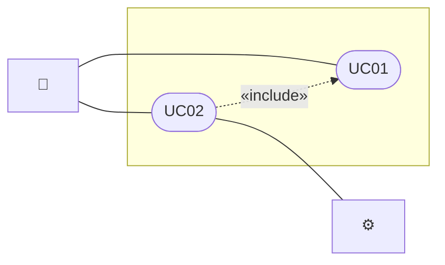

# CLAUDE.md — quy ước cho AI làm việc trong dự án

File gồm 2 phần và 3 phụ lục:

| Phần | Nội dung | Mang sang dự án khác |
|---|---|---|
| **A — Quy trình chung** | Khởi động dự án, quy trình ticket, file tiến độ, việc cấm | Giữ nguyên |
| **B — Riêng dự án này** | Stack, lệnh, kiến trúc, boilerplate, database, checklist kỹ thuật | Viết lại (AI soạn nháp ở bước A0, người dùng duyệt) |
| **Phụ lục A, B, C** | Template `AI-response-template.md`, `checklist-use-case.md`, `docs/use-cases.md` | Giữ nguyên |

Khi Phần A và Phần B mâu thuẫn: Phần A thắng về **quy trình**, Phần B thắng về **chi tiết kỹ thuật**.

---

# PHẦN A — QUY TRÌNH CHUNG (dùng cho mọi dự án)

## A0. Khởi động dự án — chạy khi bắt đầu dự án, hoặc bất cứ lúc nào thiếu file dưới đây

Trước khi xử lý prompt đầu tiên, AI kiểm tra cấu trúc sau trong thư mục gốc dự án:

```
docs/SRS.md                                ← người dùng cung cấp: yêu cầu FR-xxx, quy tắc BR-xx, câu hỏi đã chốt Qx
docs/use-cases.md                          ← đặc tả use case UCxx (Phụ lục C)
checklist-use-case.md                      ← tiến độ từng yêu cầu FR (Phụ lục B)
ticket-request/                            ← người dùng viết prompt
ticket-response/                           ← AI viết kết quả
ticket-response/AI-response-template.md    ← template response (Phụ lục A)
```

Thiếu gì thì làm theo bảng, theo đúng thứ tự:

| Thiếu | AI làm gì |
|---|---|
| `docs/SRS.md` | **Dừng, hỏi người dùng.** Không tự bịa yêu cầu. Nếu người dùng mô tả bằng lời thì AI soạn SRS (đánh mã FR-NHÓM-xx, BR-xx, ưu tiên M/S/C), đưa người dùng duyệt rồi mới làm tiếp |
| `docs/use-cases.md` | Soạn từ SRS theo **Phụ lục C**: mỗi nhóm chức năng ≥ 1 UC, mỗi FR thuộc ít nhất một UC (dòng "Yêu cầu liên quan") |
| `checklist-use-case.md` | Tạo từ SRS theo **Phụ lục B**. Dự án đã có code thì đối chiếu code để đánh trạng thái thật; chưa có code thì mọi dòng là ⬜ |
| `ticket-request/`, `ticket-response/` | Tạo thư mục rỗng |
| `ticket-response/AI-response-template.md` | Chép **nguyên văn** khối trong Phụ lục A |
| Phần B của file này trống hoặc không khớp code | Khảo sát code (build tool, cấu trúc thư mục, cách chạy test, lớp lỗi, quy ước đặt tên) rồi soạn Phần B theo khung ở mục "Khung Phần B" cuối file; **hỏi người dùng duyệt** trước khi ghi. Chưa có code → hỏi người dùng stack và kiến trúc |

Xong bước khởi động thì báo người dùng các file đã tạo, rồi mới xử lý prompt.

## A1. Ngôn ngữ

Trả lời người dùng, viết tài liệu và comment bằng **tiếng Việt**; tên class, hàm, biến, mã lỗi, tên test bằng **tiếng Anh**.

## A2. Quy trình ticket — BẮT BUỘC

```
ticket-request/<ten-luong>.md    ← người dùng viết prompt. AI chỉ ĐỌC, không sửa.
ticket-response/<ten-luong>.md   ← AI viết / cập nhật. TRÙNG TÊN FILE với request.
ticket-response/AI-response-template.md   ← template duy nhất, KHÔNG sửa nội dung file này.
checklist-use-case.md            ← AI cập nhật tiến độ sau MỖI lần chạy prompt.
```

1. **Một luồng chức năng = đúng một cặp file**, cùng tên: `ticket-request/x.md` ↔ `ticket-response/x.md`.
   Tên file viết kebab-case không dấu, ví dụ `tra-cuu-cho-trong.md`, `voucher-gioi-han-khach-cu.md`.
2. **Prompt và trạng thái trong file request.** Mỗi file request gồm nhiều prompt, mỗi prompt bắt đầu bằng một heading `#` kèm trạng thái trong ngoặc, ví dụ:
   ```
   # Prompt 1 (close)
   # Prompt 2 (reopen)
   # Prompt 3 (open)
   ```
   - `open` — prompt mới, chưa xử lý.
   - `close` — đã xử lý xong. AI **không** làm lại, chỉ đọc để hiểu bối cảnh.
   - `reopen` — đã từng xử lý nhưng người dùng mở lại (chưa đạt hoặc có yêu cầu bổ sung), cần làm lại hoặc làm tiếp.
   - Khi người dùng bảo "đọc prompt" (hoặc tương tự), AI phải quét **toàn bộ** `ticket-request/*.md` và xử lý **hết** các prompt đang `open` và `reopen`, theo thứ tự từ trên xuống trong từng file. Không bỏ sót prompt nào, không tự xử lý prompt `close`.
   - **Chỉ người dùng** được đổi trạng thái prompt. AI tuyệt đối không sửa file request, kể cả trạng thái, kể cả khi đã làm xong. Trong file response và câu trả lời trong chat, AI ghi rõ đã xử lý những prompt nào (tên file + số prompt), prompt nào chưa xong và lý do.
3. Khi được giao một request:
   - Chưa có `ticket-response/<cùng tên>.md` → chép template ra file đó rồi điền.
   - Đã có → **cập nhật chính file đó**. Không tạo `-v2`, không tạo file thứ hai cho cùng luồng.
4. **Không tạo thêm file `.md` nào khác** (không `docs/specs/`, không ghi chú, không báo cáo riêng). Ngoại lệ:
   - các file ở bước khởi động A0 (chỉ khi chưa có);
   - cập nhật tài liệu sẵn có cho khớp code: `checklist-use-case.md` và các tài liệu liệt kê ở **Phần B mục B1**.
5. File response phải theo đúng template:
   - giữ đủ các mục và đúng thứ tự, không thêm hay bớt mục;
   - mục không áp dụng thì ghi "Không có" kèm lý do ngắn;
   - xóa hết các dòng hướng dẫn bắt đầu bằng `>`;
   - bảng đầu file: `Người viết` = tên git user + "(code và spec do AI viết)", `Ngày` = ngày làm (YYYY-MM-DD).
6. Response ghi **kết quả thật**, không ghi điều mong muốn:
   - số test qua (chạy lệnh test ở Phần B, ghi đúng dòng tổng kết, ví dụ `Tests run: N, Failures: 0`), test nào đã viết, ứng với edge case nào;
   - việc chưa kiểm chứng được và lý do (ví dụ chưa chạy trên database thật);
   - SQL / lệnh người dùng phải tự chạy (mục 3.2), kèm tài khoản cần dùng;
   - quyết định AI tự đưa ra khi request không nói rõ → ghi ở mục 1.2 (nếu là việc không làm) và mục 8 dòng "Spec bị hở";
   - câu đã hỏi lại người dùng và câu trả lời → ghi ở mục 1.
7. Mã lỗi trong response phải là **mã thật của dự án** (bảng lỗi ở Phần B). Ví dụ trong template (`VALIDATION_ERROR`, `..._NOT_FOUND`) chỉ để minh họa.
8. Request mơ hồ ở chỗ làm thay đổi hành vi với người dùng (API cũ có đổi không, dữ liệu cũ xử lý sao, quy tắc trái với SRS) → **hỏi lại trước khi code**. Chi tiết kỹ thuật nhỏ thì tự quyết và ghi vào response.
9. Làm xong thì trả lời trong chat thật ngắn: đã làm gì, link file response, việc người dùng cần tự làm. Chi tiết để trong file response.

## A3. File tiến độ `checklist-use-case.md` — BẮT BUỘC

- Mỗi dự án có **đúng một** file `checklist-use-case.md` ở **thư mục gốc**, theo khung Phụ lục B.
- **Mỗi lần chạy xong prompt** (kể cả khi chỉ xong một phần) → cập nhật theo code thật:
  1. đổi trạng thái các dòng FR bị ảnh hưởng; sửa cột "Đã có" / "Còn thiếu";
  2. tính lại bảng "Tổng quan" và bảng theo nhóm (đếm lại, không cộng nhẩm);
  3. cập nhật danh sách bảng database code đang dùng (nếu có thay đổi);
  4. đổi ngày "Cập nhật lần cuối";
  5. thêm một dòng vào "Lịch sử cập nhật": ngày, tên file request + số prompt, FR nào đổi trạng thái.
- Chỉ đánh ✅ khi phần backend / logic đã trả đủ dữ liệu **và có test**; phần còn thiếu (giao diện, tích hợp thật, ...) ghi ở "Còn thiếu".
- FR trong SRS là nguồn: không tự thêm, bớt, đổi mã FR. SRS đổi → đồng bộ lại danh sách và ghi vào lịch sử.

## A4. Tài liệu yêu cầu (`docs/SRS.md`, `docs/use-cases.md`)

- Đây là yêu cầu của khách. Sau bước A0, AI **không tự sửa** hai file này.
- Ticket làm khác SRS / use case (ví dụ đổi chính sách hủy) → làm theo ticket, ghi rõ ở mục 8 response ("SRS / use case cần cập nhật: ...") và nhắc người dùng trong câu trả lời chat.
- Code ghi mã yêu cầu trong comment / Javadoc: `UCxx`, `FR-xxx`, `BR-xx`.

## A5. Không được làm (mọi dự án)

- Không thêm thư viện / dependency khi chưa hỏi người dùng.
- Không sửa file ngoài danh sách ở mục 2.2 của response. Cần sửa thêm thì bổ sung vào danh sách và nói lý do.
- Không tự commit, push hay tạo branch. Chỉ làm khi người dùng yêu cầu.
- Không xóa dữ liệu, không chạy lệnh thay đổi cấu trúc (DDL, migration) lên database thật của người dùng.
- Không sửa `ticket-request/*.md` và nội dung `ticket-response/AI-response-template.md`.

## A6. Checklist quy trình trước khi báo xong (mọi dự án)

- [ ] Đã xử lý hết prompt `open` / `reopen`; chat và response ghi rõ prompt nào xong, prompt nào chưa và lý do.
- [ ] Lệnh test ở Phần B qua **toàn bộ**, kể cả test cũ; số test ghi vào mục 7 của response.
- [ ] Đúng một file `ticket-response/<tên request>.md`, đủ mục theo template, không còn dòng `>`.
- [ ] Đã cập nhật `checklist-use-case.md` (trạng thái FR, bảng tổng quan, ngày, dòng lịch sử).
- [ ] Đã chạy checklist kỹ thuật ở Phần B.

---

# PHẦN B — RIÊNG DỰ ÁN NÀY (viết lại khi dùng cho dự án khác)

Hệ thống đặt chỗ Co-Working Space theo giờ. Backend Spring Boot 3.4 · Java 21 · JPA/Hibernate 6.6 · PostgreSQL 16 (H2 cho test).

## B1. Tài liệu của dự án

Đọc trước khi code một chức năng:
- `docs/SRS.md` — yêu cầu FR-xxx, quy tắc nghiệp vụ BR-xx, các câu hỏi đã chốt (Q1…)
- `docs/use-cases.md` — luồng chính, luồng thay thế, ngoại lệ của từng UCxx
- `docs/database.md` + `backend/db/schema.sql` — thiết kế 36 bảng
- `README.md` mục 6–9 — kiến trúc, cách một request đi qua code, quy ước code
- `checklist-use-case.md` — tiến độ từng yêu cầu FR

Tài liệu AI được sửa cho khớp code (ngoại lệ của quy tắc A2.4): `README.md`, `backend/README.md`, `docs/database.md`.

## B2. Lệnh

```bash
cd backend
mvn test                                              # toàn bộ test, chạy trên H2, không cần PostgreSQL
mvn spring-boot:run -Dspring-boot.run.profiles=h2     # chạy app với H2 + dữ liệu mẫu (DemoDataSeeder)
mvn spring-boot:run                                   # chạy với PostgreSQL (localhost:5432/working-space, user cowork)
```

- Profile mặc định dùng `ddl-auto: validate`: entity lệch với bảng thì app dừng ngay lúc khởi động (`Schema-validation: ...`).
- User `cowork` **không có quyền** sửa cấu trúc bảng. Mọi `ALTER/CREATE TABLE` phải do người dùng chạy bằng tài khoản `postgres`. AI không tự chạy DDL lên database của người dùng; ghi SQL vào mục 3.2 của response.
- Tài khoản nhân viên mẫu (H2 và `data.sql`): mật khẩu `Cowork@123`. Integration test lấy token bằng `adminAuth()`, `managerAuth()`, `receptionistAuth()`, `technicianAuth()`; mã OTP trong test luôn `123456`.

## B3. Kiến trúc và boilerplate

### B3.1. Cấu trúc package (`backend/src/main/java/com/cowork/`)

```
presentation/controller/   Controller REST + ApiExceptionHandler (đổi exception → ProblemDetail) + Roles (@PreAuthorize)
business/service/          Toàn bộ quy tắc nghiệp vụ, mở transaction
business/job/              Việc chạy định kỳ (@Scheduled), chỉ gọi service
business/exception/        DomainException, ConflictException, NotFoundException, AuthenticationFailedException
dataaccess/entity/         ĐÚNG 36 entity — mỗi bảng 1 class, tên class = tên bảng PascalCase
dataaccess/enums/          Enum cho cột trạng thái / loại (BookingStatus, ResourceTypeCode...)
dataaccess/valueobject/    Money, TimeRange, ContactInfo (không có id, không đổi sau khi tạo)
dataaccess/repository/     Mỗi bảng 1 interface extends JpaRepository
dataaccess/integration/    Hệ thống ngoài: cổng thanh toán, gửi tin, chữ ký webhook
dto/                       XxxDtos (record request/response), Actor (người đang gọi), dùng chung cho controller và service
config/                    @ConfigurationProperties, Clock, SecurityConfig (JWT + RBAC), DemoDataSeeder
```

Chiều gọi chỉ đi từ trên xuống: `presentation → business → dataaccess`.
- Controller **không** dùng repository.
- Service **không** biết HTTP (không `ResponseEntity`, `HttpServletRequest`, `Jwt`, không import `presentation`). Người đang gọi truyền xuống bằng `dto.Actor`.
- `dataaccess` **không** import `business` hay `presentation`.
- Service gọi thẳng service khác. Không dùng event.

### B3.2. Entity (`dataaccess/entity/`)

- Số entity luôn bằng số bảng trong `schema.sql`; tên class = tên bảng PascalCase (`space_resource` → `SpaceResource`). Thêm bảng thì thêm entity, không có ngoại lệ (kể cả bảng nối, bảng con).
- Chỉ có field + getter/setter + constructor. **Không** có quy tắc nghiệp vụ, không ném lỗi nghiệp vụ. Ngoại lệ đã có: hàm tính toán chỉ đọc kiểu `Booking.getTotal()`.
- Không dùng Lombok (chưa có trong `pom.xml`). Getter/setter viết tay.
- Khóa ghép dùng `@IdClass` với class `Key` lồng bên trong (xem `BookingCharge`, `VoucherResourceType`).
- Thêm giá trị enum mới → phải sửa ràng buộc `CHECK` tương ứng trong `schema.sql` và ghi SQL vào response.
- Không dùng `@Data`, `@ToString`, `@EqualsAndHashCode` hay tự viết `equals`/`hashCode` dựa trên quan hệ LAZY.

```java
/** Mô tả ngắn. Bảng: {@code ten_bang}. */
@Entity
@Table(name = "ten_bang")
public class TenBang {

    @Id
    @GeneratedValue(strategy = GenerationType.IDENTITY)
    private Long id;

    @ManyToOne(fetch = FetchType.LAZY, optional = false)
    @JoinColumn(name = "booking_id", nullable = false)
    private Booking booking;

    @Enumerated(EnumType.STRING)
    @Column(nullable = false, length = 20)
    private TenBangStatus status = TenBangStatus.ACTIVE;

    @Column(name = "created_at", nullable = false)      // cột nhiều từ: ghi rõ name
    private LocalDateTime createdAt;

    @Version                                            // chỉ khi bảng có cột version (chống ghi đè đồng thời)
    private Long version;

    public TenBang() {
    }

    // getter / setter cho từng field
}
```

### B3.3. Repository (`dataaccess/repository/`)

```java
public interface TenBangRepository extends JpaRepository<TenBang, Long> {

    List<TenBang> findByStatusOrderByCodeAsc(TenBangStatus status);   // ưu tiên query method

    /** Câu phức tạp: JPQL + ghi rõ mục đích. Nạp kèm quan hệ bằng join fetch để tránh N+1. */
    @Query("""
            select t from TenBang t
            join fetch t.booking b
            where b.id = :bookingId
            """)
    List<TenBang> findWithBooking(@Param("bookingId") Long bookingId);
}
```
- Không viết lớp cài đặt repository. Tham số enum trong JPQL ghi đầy đủ: `com.cowork.dataaccess.enums.ResourceStatus.ACTIVE`.
- Tránh `(:param is null or ...)` trong JPQL (dễ lỗi kiểu tham số null trên PostgreSQL). Lọc tùy chọn thì làm trong Java, tách hàm, hoặc dùng `Specification` (xem `BookingService.specOf`).
- Chỉ cần vài cột → interface projection lồng trong repository (xem `BookingRepository.Occupancy`).
- `@EntityGraph` trên hàm có sẵn dùng `type = LOAD`, nếu không các quan hệ EAGER khác thành LAZY.

### B3.4. Service (`business/service/`)

```java
/** UCxx: mô tả nghiệp vụ. */
@Service
@Transactional                       // service chỉ đọc: @Transactional(readOnly = true)
public class TenService {

    private final TenBangRepository items;
    private final Clock clock;

    public TenService(TenBangRepository items, Clock clock) {   // constructor injection, không @Autowired field
        this.items = items;
        this.clock = clock;
    }

    /** UCxx: ... (BR-yy). */
    public TenBang doSomething(Long id) {
        TenBang item = items.findById(id).orElseThrow(() -> new NotFoundException("Tên đối tượng", id));
        if (item.getStatus() != TenBangStatus.ACTIVE) {
            throw new ConflictException("ITEM_NOT_ACTIVE", "Thông báo tiếng Việt cho người dùng");
        }
        item.setUpdatedAt(LocalDateTime.now(clock));
        return items.save(item);
    }
}
```
- Mỗi nghiệp vụ nằm trong một service (bảng phân công ở README mục 6.2). Quy tắc dùng chung cho nhiều service tách thành `@Component` riêng trong `business/service/` (ví dụ `BookingWindowPolicy`).
- Đổi trạng thái đơn **chỉ** qua `BookingService.changeStatus(...)` (hàm này ghi lịch sử), không gọi thẳng `booking.setStatus(...)`.
- Thao tác có thể chiếm thêm thời gian của một vị trí phải khóa dòng vị trí trước (`SpaceResourceRepository.findByIdForUpdate`) rồi mới kiểm tra trùng (BR-01). Thứ tự khóa: vị trí → add-on (id tăng dần) → voucher → gói thành viên.
- Gửi thông báo (`NotificationService`) đặt **sau** lệnh lưu.
- **Thời gian:** luôn `LocalDateTime.now(clock)`, không gọi `LocalDateTime.now()` không tham số. Khoảng thời gian là nửa mở `[start, end)`.
- **Tiền:** luôn `Money` (VND, số nguyên `long`), không dùng `double`/`float`. Khoản giảm trừ trong `booking_charge` vẫn có `amount >= 0`, nhận biết qua `ChargeType.isDeduction()`.
- **Tham số nghiệp vụ** (thời lượng, hệ số, giới hạn) đặt trong `application.yml` + record `@ConfigurationProperties` ở `config/` (xem `BookingProperties`), không viết số cứng trong code.
- **Phân quyền:** vai trò kiểm ở controller bằng `@PreAuthorize(Roles.XXX)`; quyền sở hữu (khách chỉ thấy đơn của mình) kiểm ở service qua `Actor`. Bảng quyền: `ticket-response/authentication.md` mục 5.1.
- Javadoc ghi mã yêu cầu: `/** UC08: ... (BR-07) */`.

### B3.5. Lỗi và mã lỗi

| Ném | HTTP | `code` |
|---|---|---|
| `new DomainException("MA_LOI", "thông báo")` | 422 | `MA_LOI` (tự đặt, UPPER_SNAKE_CASE) |
| `new ConflictException("MA_LOI", "thông báo")` | 409 | `MA_LOI` |
| `new NotFoundException("Tên đối tượng", id)` | 404 | `NOT_FOUND` |
| `new AuthenticationFailedException("MA_LOI", "thông báo")` | 401 | `MA_LOI` (ví dụ `INVALID_CREDENTIALS`) |
| Không có / sai / hết hạn token · sai vai trò (do `SecurityConfig`) | 401 · 403 | `UNAUTHORIZED` · `FORBIDDEN` |
| Sai `@Valid`, thiếu tham số, sai kiểu tham số, body / enum sai (do Spring ném) | 400 | `VALIDATION_FAILED` |
| `ObjectOptimisticLockingFailureException` | 409 | `CONCURRENT_UPDATE` |
| Vi phạm ràng buộc database (xóa dòng đang được tham chiếu...) | 409 | `DATA_CONFLICT` |

- Response lỗi là `ProblemDetail` có thêm trường `code`. Controller không viết `try/catch`; loại lỗi mới thì thêm handler vào `ApiExceptionHandler`.
- Mã lỗi đã có thì dùng lại, không đặt tên mới cho cùng một ý: `INVALID_TIME_RANGE`, `START_IN_PAST`, `DURATION_TOO_SHORT`, `OUTSIDE_OPENING_HOURS`, `BRANCH_CLOSED`, `SLOT_UNAVAILABLE`, `RESOURCE_NOT_BOOKABLE`, `CAPACITY_EXCEEDED`, `INVALID_BOOKING_STATE`, `CODE_ALREADY_EXISTS`, `CHANGE_DEADLINE_PASSED`…

### B3.6. Controller và DTO

```java
@RestController
@RequestMapping("/api")
class TenController {                                   // package-private

    private final TenService tenService;

    TenController(TenService tenService) {
        this.tenService = tenService;
    }

    @PostMapping("/items")
    @ResponseStatus(HttpStatus.CREATED)                 // tạo mới → 201
    @PreAuthorize(Roles.ADMIN_MANAGER)                  // vai trò được gọi; API công khai khai báo trong SecurityConfig
    ItemResponse create(@Valid @RequestBody CreateItemRequest request) {
        return ItemResponse.from(tenService.create(request));
    }
}
```

```java
public final class TenDtos {                            // dto/TenDtos.java, gom record của một luồng

    private TenDtos() {
    }

    public record CreateItemRequest(@NotNull Long bookingId, @Min(1) int quantity) {
    }

    public record ItemResponse(Long id, String code) {

        public static ItemResponse from(TenBang t) {
            return new ItemResponse(t.getId(), t.getCode());
        }
    }
}
```
- Không trả entity ra JSON; luôn chuyển qua `XxxResponse.from(...)`. Response cần quan hệ LAZY → chuyển DTO ngay trong service (transaction còn mở).
- Ngày giờ trong API dạng ISO `2026-11-02T09:00:00` (`@DateTimeFormat(iso = DateTimeFormat.ISO.DATE_TIME)` cho query param), theo giờ `Asia/Ho_Chi_Minh`.
- Thêm hoặc đổi endpoint → cập nhật bảng API (kèm cột quyền) trong `backend/README.md`.

### B3.7. Test (`backend/src/test/java/com/cowork/`)

- **Unit test** quy tắc nghiệp vụ: `business/service/XxxServiceTest`, dùng Mockito (`mock(...)`), dựng service bằng `new`, đồng hồ dùng `MutableClock` (`clock.set(...)`). Không cần Spring.
- **Integration test** luồng API: kế thừa `support/IntegrationTest` (MockMvc + H2 + dữ liệu `DemoDataSeeder`), lấy vị trí bằng `resource("HD-01")`, token bằng `receptionistAuth()`...
- Các integration test dùng chung một database, nên **mỗi class dùng ngày và vị trí riêng**. Danh sách ngày đang dùng ở README mục 9; thêm test mới thì chọn ngày chưa ai dùng và cập nhật danh sách đó. Add-on tính tồn kho theo cả chi nhánh nên test có add-on cần ngày riêng cho cả chi nhánh.
- Tên hàm test bằng tiếng Anh, mô tả hành vi: `rejectsWindowOutsideOpeningHours`. Mỗi edge case trong mục 6 của response phải chỉ ra được test tương ứng ở mục 7.1.

## B4. Database

- `backend/db/schema.sql` là nguồn gốc. Thêm hoặc đổi bảng, cột:
  1. sửa `CREATE TABLE` trong `schema.sql` (file này xóa và tạo lại toàn bộ bảng);
  2. ghi câu `ALTER TABLE ... IF NOT EXISTS` cho database đang có dữ liệu vào mục 3.2 của response;
  3. sửa entity cho khớp; cập nhật bảng cột trong `docs/database.md`;
  4. dữ liệu mẫu phải khớp ở **cả hai** nơi: `backend/db/data.sql` (PostgreSQL) và `config/DemoDataSeeder` (H2, test). Mã vị trí, tiện ích, chi nhánh, email nhân viên trùng nhau giữa hai nơi.
- Khóa chính `bigint GENERATED BY DEFAULT AS IDENTITY` ↔ `Long` + `@GeneratedValue(IDENTITY)`.
- Đặt tên ràng buộc: `pk_`, `fk_`, `uq_`, `ck_`, `ex_`, index `idx_` / `ux_`.

## B5. Không được làm (riêng dự án)

- Không thêm thư viện vào `pom.xml` khi chưa hỏi người dùng.
- Không dùng Lombok.

## B6. Checklist kỹ thuật trước khi báo xong

- [ ] `mvn test` qua toàn bộ; ghi số test vào mục 7 của response.
- [ ] Số entity = số bảng; tên class = tên bảng PascalCase.
- [ ] Đổi schema → đã sửa `schema.sql`, `data.sql`, `DemoDataSeeder`, `docs/database.md`, và ghi SQL migration vào response.
- [ ] Đổi API → đã cập nhật `backend/README.md`.
- [ ] Không có import thừa, không có code chết (hàm repository không còn ai gọi thì xóa).

### Khung Phần B (dùng khi chuyển sang dự án khác)

Phần B của dự án mới phải có đủ các mục sau (nội dung lấy từ code thật, người dùng duyệt):

| Mục | Phải ghi |
|---|---|
| Mở đầu | Tên dự án, stack (ngôn ngữ, framework, database) |
| B1. Tài liệu | Danh sách tài liệu cần đọc; tài liệu AI được sửa cho khớp code |
| B2. Lệnh | Lệnh build, chạy, **chạy toàn bộ test**; giới hạn quyền database |
| B3. Kiến trúc | Cấu trúc thư mục, chiều phụ thuộc giữa tầng, một đoạn code mẫu cho mỗi loại lớp chính, bảng lớp lỗi → HTTP → mã lỗi, quy ước test |
| B4. Database | Nguồn schema, quy trình thêm / đổi cột, dữ liệu mẫu, quy ước đặt tên |
| B5. Không được làm | Việc cấm riêng của stack này |
| B6. Checklist kỹ thuật | Các bước tự kiểm tra trước khi báo xong |

---

# PHỤ LỤC A — Template `ticket-response/AI-response-template.md`

Bước A0 chép **nguyên văn** nội dung trong khối dưới (bỏ dòng mở / đóng khối) ra file `ticket-response/AI-response-template.md`. Dự án đã có file này thì dùng file của dự án.

````markdown
# SPEC: <Tên tính năng / tên bug>

> **Cách dùng template này**
> - Chép file này ra `ticket-response/<tên file request>.md` (trùng tên với file trong `ticket-request/`, ví dụ `ticket-response/voucher-gioi-han-khach-cu.md`), rồi điền vào từng mục.
> - Dòng nào bắt đầu bằng `>` là hướng dẫn. Viết xong thì xóa hết các dòng đó.
> - Viết sao cho **người lạ (hoặc AI) đọc mỗi file này là code được**, không cần hỏi lại câu nào.
> - Mục nào không áp dụng thì ghi rõ "Không có", đừng xóa mục đó. Ghi "Không có" nghĩa là bạn đã nghĩ tới và quyết định như vậy.

| Mục | Nội dung |
|---|---|
| Loại | Tính năng mới / Sửa bug / Refactor |
| Liên kết | Issue #..., UC.., FR-..., BR-.. |
| Người viết | ... |
| Ngày | YYYY-MM-DD |

---

## 1. Mục tiêu (Goal)

> Viết 1–3 câu: ai được gì sau khi làm xong. Đừng mô tả cách code ở đây.
> Ví dụ: "Voucher có thể giới hạn chỉ cho khách đã đăng ký trên 30 ngày và có tổng đơn từ 500.000đ trở lên."
> Ghi thêm: đã xử lý prompt nào (tên file request + số prompt); câu đã hỏi lại người dùng và câu trả lời.

...

### 1.1. Bug (chỉ điền nếu là sửa lỗi)

| | |
|---|---|
| Các bước tái hiện | 1. ... 2. ... 3. ... |
| Kết quả hiện tại | ... |
| Kết quả mong muốn | ... |
| Nguyên nhân (đã tìm được) | File `...`, hàm `...`, dòng ... làm sai vì ... |

### 1.2. Ngoài phạm vi (Out of scope)

> Liệt kê những thứ KHÔNG làm lần này. Mục này giúp AI không tự ý "làm thêm cho đủ".

- Không làm giao diện.
- Không sửa luồng ...

---

## 2. Context — code hiện tại liên quan

> Điền từ kết quả bạn tự lần luồng (Bước 2). Ghi đúng tên file và tên hàm.

### 2.1. Luồng hiện tại

```
<METHOD> /api/...                 (presentation)
  → XxxController.method()
  → XxxService.method()           (business)  ← logic chính ở đây
      → YyyService.method()
  → XxxRepository.method()        (dataaccess)
  → bảng: xxx, yyy
```

### 2.2. File sẽ phải sửa / tạo

| File | Sửa hay tạo mới | Sửa cái gì |
|---|---|---|
| `src/.../XxxService` | Sửa | Thêm kiểm tra ... trong hàm `...` |
| `src/.../XxxRepository` | Sửa | Thêm truy vấn `...` |
| `db/schema.sql` | Sửa | Thêm cột ... |
| `test/.../XxxServiceTest` | Sửa | Thêm test cho các trường hợp ở mục 6 |

### 2.3. File KHÔNG được đụng vào

> Rất quan trọng khi giao cho AI.

- `...`

### 2.4. Quy ước code phải theo

> Lấy từ Phần B của CLAUDE.md, chỉ ghi những quy ước liên quan tới ticket này.
> Ví dụ: quy tắc nghiệp vụ viết trong service, không viết trong entity; lỗi nghiệp vụ ném `DomainException("MA_LOI", "thông báo")`.

- ...

---

## 3. Data Model Change — thay đổi database

> Không có thay đổi thì ghi "Không có".

### 3.1. Thay đổi bảng

| Bảng | Thay đổi | Cột | Kiểu | Null? | Mặc định | Ràng buộc / Ghi chú |
|---|---|---|---|---|---|---|
| `voucher` | Thêm cột | `min_account_age_days` | `integer` | Có | `NULL` | `CHECK (>= 0)`. NULL = không giới hạn |
| ... | | | | | | |

### 3.2. SQL

> SQL người dùng phải tự chạy, ghi rõ tài khoản database cần dùng. Chạy lại nhiều lần không lỗi.

```sql
ALTER TABLE ... ADD COLUMN IF NOT EXISTS ...;
```

### 3.3. Dữ liệu cũ

> Các dòng đang có trong bảng sẽ nhận giá trị gì? Có cần cập nhật dữ liệu cũ không?

...

### 3.4. Entity / DTO cần cập nhật

| Lớp | Field mới | Kiểu |
|---|---|---|
| `Voucher` | `minAccountAgeDays` | `Integer` |

---

## 4. API Contract

> Mỗi endpoint mới hoặc bị thay đổi viết một khối, ghi rõ ai được gọi. Không đổi API thì ghi "Không có".

### `<METHOD> /api/...`

**Request**
```json
{
  "field": "kiểu — bắt buộc? — giới hạn"
}
```

**Response thành công** — `200 / 201`
```json
{
}
```

**Response lỗi**

| HTTP | `code` | Khi nào |
|---|---|---|
| 400 | `VALIDATION_ERROR` | Thiếu field / sai định dạng |
| 404 | `..._NOT_FOUND` | ... |
| 409 | `...` | ... |

---

## 5. Logic Flow — các bước xử lý

> Viết theo thứ tự từ lúc nhận request tới lúc trả response. Mỗi bước ghi rõ nằm ở hàm nào.
> Chỗ nào rẽ nhánh thì ghi điều kiện và kết quả của nhánh đó.

1. `Controller` nhận request, kiểm tra dữ liệu đầu vào.
2. `Service.xxx()` mở transaction.
3. Tải ... từ DB. Không có → ném `..._NOT_FOUND`.
4. Kiểm tra quy tắc:
   - Nếu ... → ném `...`.
   - Nếu ... → ...
5. Tính ... theo công thức: `...`
6. Lưu ... (bảng ...).
7. Gọi ... (thông báo, cổng thanh toán...).
8. Commit, trả về ...

### 5.1. Quy tắc nghiệp vụ / công thức

> Viết công thức và ví dụ có số cụ thể. Nhờ có số mà AI kiểm tra được mình tính đúng hay sai.

| Quy tắc | Công thức | Ví dụ |
|---|---|---|
| ... | ... | Đầu vào ... → kết quả ... |

### 5.2. Transaction và đồng thời

> Những bước nào phải nằm chung một transaction? Có cần khóa dòng (`FOR UPDATE`) không? Hai request cùng lúc thì chuyện gì xảy ra?

...

---

## 6. Edge Cases — mục quan trọng nhất

> Mỗi dòng là một tình huống, kèm kết quả mong đợi rõ ràng (mã lỗi, trạng thái, dữ liệu trong DB).
> Viết xong mục này thì nó chính là danh sách test case.

| # | Tình huống | Kết quả mong đợi | Dữ liệu sau đó |
|---|---|---|---|
| E1 | Chưa đăng nhập / không có quyền | `401` / `403` | Không đổi gì |
| E2 | Dữ liệu đầu vào thiếu, sai định dạng, số âm, chuỗi rỗng | `400 VALIDATION_ERROR` | Không đổi gì |
| E3 | Đối tượng không tồn tại | `404 ..._NOT_FOUND` | Không đổi gì |
| E4 | Đối tượng ở trạng thái không cho phép (đã hủy, đã hết hạn...) | `409 ...` | Không đổi gì |
| E5 | Giá trị nằm đúng ở biên (đúng 30 ngày, đúng 500.000đ, đúng giờ hết hạn) | ... (ghi rõ `>` hay `>=`) | ... |
| E6 | Hết hạn đúng lúc đang xử lý | ... | ... |
| E7 | Hai request cùng lúc cho cùng một tài nguyên | Một cái thành công, cái kia `409` | Chỉ một bản ghi |
| E8 | Gửi lặp cùng một request (bấm 2 lần, retry) | Không tạo trùng | ... |
| E9 | DB lỗi giữa chừng | Rollback toàn bộ, trả `500` | Như trước khi gọi |
| E10 | Dịch vụ ngoài (cổng thanh toán, SMS) lỗi hoặc timeout | ... | ... |
| E11 | Dữ liệu cũ (tạo trước khi có tính năng này) | ... | ... |
| ... | | | |

---

## 7. Tiêu chí hoàn thành (Acceptance Criteria)

- [ ] Mọi edge case ở mục 6 đều có test và test qua.
- [ ] Lệnh test của dự án qua toàn bộ, kể cả các test cũ (ghi dòng tổng kết thật, ví dụ `Tests run: N, Failures: 0`).
- [ ] Chạy lại SQL ở mục 3.2 nhiều lần không lỗi (dùng `IF NOT EXISTS`).
- [ ] Không sửa file nào ngoài danh sách ở mục 2.2.
- [ ] Đúng quy ước ở mục 2.4.
- [ ] Đã cập nhật `checklist-use-case.md`.
- [ ] ...

### 7.1. Test cần viết

| Test | Loại | Kiểm tra edge case |
|---|---|---|
| `XxxServiceTest.rejectsWhen...` | Unit | E4 |
| `XxxIntegrationTest....` | Integration | E7 |

### 7.2. Kiểm tra tay

```bash
curl -X POST http://localhost:8080/api/... -H "Content-Type: application/json" -d '{ }'
```

Kết quả mong đợi: ...

---

## 8. Sau khi AI làm xong — tự đánh giá spec

> Điền sau khi xem kết quả. Mục này giúp lần sau viết spec tốt hơn.

| Câu hỏi | Trả lời |
|---|---|
| Code chạy đúng ngay lần đầu? | Có / Không |
| Phải chat lại mấy lần để sửa? | ... |
| AI làm sai ở đâu? | ... |
| Spec bị hở ở mục nào (thiếu edge case, mơ hồ, thiếu tên file...)? | ... (kèm quyết định AI tự đưa ra; SRS / use case nào cần cập nhật) |
| Lần sau cần bổ sung gì vào template? | ... |

---

## Checklist

- [ ] Mục 2 có tên file và tên hàm thật, đã mở code ra kiểm tra.
- [ ] Mục 3 ghi đủ kiểu dữ liệu, null, mặc định, dữ liệu cũ.
- [ ] Mục 5 không có câu kiểu "xử lý cho phù hợp" hay "kiểm tra hợp lệ" mà không nói kiểm tra cái gì.
- [ ] Mục 6 có ít nhất: quyền, đầu vào sai, không tồn tại, sai trạng thái, giá trị ở biên, đồng thời, lỗi giữa chừng.
- [ ] Mỗi edge case có kết quả cụ thể: mã HTTP + mã lỗi + trạng thái dữ liệu.
- [ ] Đã ghi mục "Ngoài phạm vi" và "File không được đụng".
````

---

# PHỤ LỤC B — Template `checklist-use-case.md` (thư mục gốc)

- Một nhóm trong SRS (ví dụ `AUTH`, `BOOK`) = một mục `##`; mỗi FR = một dòng bảng, giữ nguyên mã, ưu tiên, UC như SRS.
- Trạng thái chỉ dùng 3 ký hiệu: ✅ Hoàn thành · 🟡 Làm một phần · ⬜ Chưa làm.
- Bảng "Tổng quan" và "theo nhóm" đếm lại mỗi lần cập nhật; tổng ba cột phải bằng số FR.
- Dòng "Bảng:" dưới mỗi nhóm liệt kê bảng database của luồng; bảng code đang dùng đánh dấu ✔. Dự án không có database thì bỏ dòng này và mục "Bảng database".

````markdown
# Tiến độ yêu cầu chức năng — <Tên dự án>

Đối chiếu từng yêu cầu FR trong `docs/SRS.md` với code hiện tại. Phần nào backend đã trả đủ dữ liệu và có test thì tính là xong; phần còn thiếu ghi ở cột **Còn thiếu**.

- Trạng thái: ✅ Hoàn thành · 🟡 Làm một phần · ⬜ Chưa làm
- Ưu tiên: M = bắt buộc, S = nên có, C = có thì tốt.
- **Cập nhật lần cuối: YYYY-MM-DD**, theo code sau ticket `<ten-luong>.md` (Prompt n). Lịch sử ở cuối file.

## Tổng quan

| Chỉ số | Giá trị |
|---|---|
| Yêu cầu chức năng | <tổng số FR> |
| ✅ Hoàn thành | 0 |
| 🟡 Làm một phần | 0 |
| ⬜ Chưa làm | 0 |
| Bảng database code đang dùng | 0 / <tổng số bảng> |

| Nhóm | ✅ | 🟡 | ⬜ | Tổng |
|---|---:|---:|---:|---:|
| [<MÃ> · <Tên nhóm>](#<anchor>) | 0 | 0 | 0 | 0 |

---

## <MÃ NHÓM> · <Tên nhóm>

Bảng: `bang_a` ✔, `bang_b`

| Mã | Ưu tiên | UC | Trạng thái | Yêu cầu | Đã có | Còn thiếu |
|---|---|---|---|---|---|---|
| FR-<NHÓM>-01 | M | UC01 | ⬜ | <Nội dung yêu cầu, rút gọn từ SRS> | <Endpoint / hàm / test đã có> | <Phần chưa làm> |

---

## Bảng database

✔ = code đang dùng (có entity / model và được đọc / ghi). **0 / <tổng>** bảng.

| Bảng | Dùng | Nội dung |
|---|---|---|
| `bang_a` | ✔ | <Mô tả ngắn> |
| `bang_b` | | <Mô tả ngắn> |

---

## Lịch sử cập nhật

| Ngày | Ticket / prompt | Thay đổi trạng thái |
|---|---|---|
| YYYY-MM-DD | — | Tạo file từ `docs/SRS.md` |
| YYYY-MM-DD | `<ten-luong>.md` Prompt n | FR-xxx-01 → ✅; FR-xxx-02 → 🟡 (còn ...) |
````

---

# PHỤ LỤC C — Template `docs/use-cases.md`

- Mã UC đánh liên tục `UC01`, `UC02`…; mỗi FR trong SRS phải xuất hiện ở dòng "Yêu cầu liên quan" của ít nhất một UC.
- Luồng thay thế / ngoại lệ đánh số theo bước của luồng chính: `3a`, `4b`…
- Sơ đồ dùng Mermaid `flowchart` (Mermaid chưa có ký pháp use case): hình bo tròn là UC, khung lớn là ranh giới hệ thống, mũi tên nét đứt là «include» / «extend».

````markdown
# Đặc Tả Use Case
**Dự án:** <Tên dự án>
**Phiên bản:** 1.0 — DD/MM/YYYY
**Tài liệu liên quan:** [SRS](SRS.md)

---

## 1. Danh sách Actor

| Actor | Loại | Mô tả |
| :--- | :--- | :--- |
| <Tên actor> | Chính / Phụ (hệ thống) / Chính (thời gian) | <Vai trò, quan hệ kế thừa nếu có> |

## 2. Danh sách Use Case

| ID | Tên Use Case | Actor chính | Mức ưu tiên |
| :--- | :--- | :--- | :---: |
| UC01 | <Tên> | <Actor> | M |

---

## 3. Sơ đồ Use Case

### 3.1. Tổng quan



### 3.2. Phân rã theo Actor — <Actor>

> Thêm một sơ đồ cho mỗi actor chính có nhiều use case.

---

## 4. Đặc tả chi tiết Use Case

### UC01 — <Tên use case>
| Mục | Nội dung |
| :--- | :--- |
| Actor chính | <Actor> |
| Actor phụ | <Hệ thống ngoài / không có> |
| Mô tả | <Một câu: actor làm gì, đạt được gì> |
| Tiền điều kiện | <Điều kiện trước khi bắt đầu> |
| Hậu điều kiện thành công | <Trạng thái dữ liệu khi thành công> |
| Hậu điều kiện thất bại | <Trạng thái dữ liệu khi thất bại> |
| Kích hoạt | <Hành động bắt đầu use case> |

**Luồng chính**
1. <Actor> ...
2. Hệ thống ...

**Luồng thay thế**
- 2a. <Điều kiện>: <hệ thống làm gì>, quay lại bước n.

**Ngoại lệ**
- 2b. <Lỗi>: <hệ thống báo gì>, <dữ liệu thế nào>.

**Quy tắc:** BR-xx, BR-yy.
**Yêu cầu liên quan:** FR-<NHÓM>-01..03.

---
````
