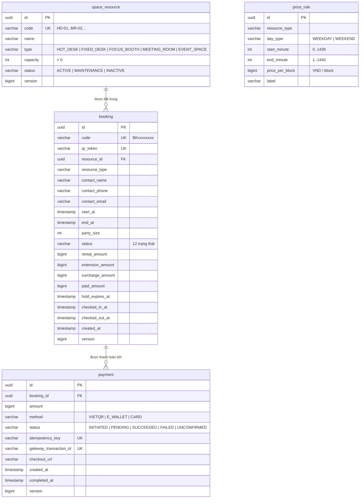
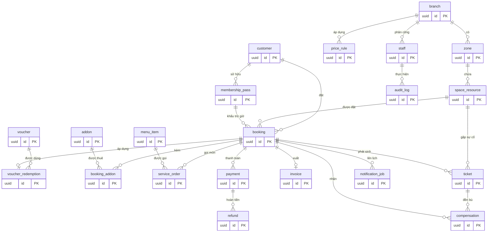

# Thiết Kế Cơ Sở Dữ Liệu
**Dự án:** Hệ thống đặt chỗ Co-Working Space theo giờ
**DBMS:** PostgreSQL 16+ (đang dùng 18)
**Tài liệu liên quan:** [SRS mục 5](SRS.md#5-yêu-cầu-dữ-liệu) · [State diagrams](diagrams.md#3-state-diagrams)
**Script tạo bảng:** [`backend/src/main/resources/db/migration`](../backend/src/main/resources/db/migration)

> Các bảng đánh dấu ✅ đã có trong migration và đang được code sử dụng.
> Các bảng đánh dấu 🕓 là **thiết kế cho giai đoạn sau**: khi làm chức năng tương ứng thì viết thêm migration mới theo đúng thiết kế ở đây.

---

## 1. Quy ước

| Quy ước | Chi tiết |
| :--- | :--- |
| Tên bảng, tên cột | `snake_case`, số ít (`booking`, không phải `bookings`). Bảng chỗ ngồi tên `space_resource` để tránh trùng từ khóa `resource` |
| Khóa chính | `id uuid`, do ứng dụng sinh (`UUID.randomUUID()`), không dùng sequence |
| Thời gian | `timestamp(6)` **không** kèm múi giờ; mọi giá trị hiểu theo giờ `Asia/Ho_Chi_Minh` (hệ thống chỉ chạy một múi giờ) |
| Tiền | `bigint`, đơn vị **VND**, không có phần lẻ, `CHECK (... >= 0)` |
| Enum | `varchar` + `CHECK (col IN (...))`, giá trị trùng tên enum Java. Thêm giá trị enum mới thì **phải** viết migration sửa `CHECK` |
| Khóa lạc quan | Cột `version bigint` trên bảng của aggregate (`@Version` trong JPA) |
| Khoảng thời gian | Hai cột `start_at`, `end_at`, hiểu là nửa mở `[start_at, end_at)` |
| Tên ràng buộc | `pk_`, `fk_`, `uq_`, `ck_`, `ex_` (exclusion), `idx_` (index) + tên bảng + ý nghĩa |
| Quản lý schema | **Flyway**. Không sửa file migration đã chạy; muốn đổi schema thì tạo file mới `V{n}__mo_ta.sql` |

## 2. Sơ đồ quan hệ (ERD)

### 2.1. Các bảng đang dùng



`price_rule` không có khóa ngoại: nó gắn với **loại** không gian (`resource_type`), không gắn với từng vị trí.

### 2.2. Thiết kế đầy đủ (gồm các bảng giai đoạn sau)



---

## 3. Chi tiết các bảng đang dùng ✅

### 3.1. `space_resource` — vị trí cho thuê (context Space)

| Cột | Kiểu | Ràng buộc | Ghi chú |
| :--- | :--- | :--- | :--- |
| id | uuid | PK | |
| code | varchar(20) | NOT NULL, UNIQUE | Mã hiển thị trên sơ đồ |
| name | varchar(255) | NOT NULL | |
| type | varchar(20) | NOT NULL, CHECK enum | `ResourceType` |
| capacity | integer | NOT NULL, > 0 | Sức chứa (BR-14) |
| status | varchar(20) | NOT NULL, CHECK enum | `ACTIVE`, `MAINTENANCE`, `INACTIVE` (BR-09) |
| version | bigint | | Khóa lạc quan |

Hàng của bảng này bị **khóa ghi** (`SELECT … FOR UPDATE`) mỗi khi giữ chỗ hoặc gia hạn, để tuần tự hóa các yêu cầu trên cùng một vị trí.

### 3.2. `price_rule` — bảng giá (context Pricing)

| Cột | Kiểu | Ràng buộc | Ghi chú |
| :--- | :--- | :--- | :--- |
| id | uuid | PK | |
| resource_type | varchar(20) | NOT NULL, CHECK enum | |
| day_type | varchar(10) | NOT NULL, CHECK enum | `WEEKDAY`, `WEEKEND` |
| start_minute | integer | NOT NULL | Phút trong ngày, 540 = 09:00 |
| end_minute | integer | NOT NULL | Không tính phút này, 1440 = hết ngày |
| price_per_block | bigint | NOT NULL, ≥ 0 | Giá một block (mặc định 30 phút) |
| label | varchar(50) | NOT NULL | "Cao điểm", "Thấp điểm sáng"… |

- `ck_price_rule_window`: `0 ≤ start_minute < end_minute ≤ 1440`.
- `ex_price_rule_no_overlap`: với cùng loại không gian và loại ngày, hai khung giờ giá **không được chồng nhau**. Nhờ vậy mỗi thời điểm có đúng một mức giá.

### 3.3. `booking` — đơn đặt chỗ (context Booking)

| Cột | Kiểu | Ràng buộc | Ghi chú |
| :--- | :--- | :--- | :--- |
| id | uuid | PK | |
| code | varchar(12) | NOT NULL, UNIQUE | Mã đơn cho khách, ví dụ `BK7Q2M9XKA` |
| qr_token | varchar(64) | NOT NULL, UNIQUE | Nội dung mã QR, ngẫu nhiên 256 bit |
| resource_id | uuid | NOT NULL, FK → space_resource | |
| resource_type | varchar(20) | NOT NULL | Lưu kèm để tính giá không phải join |
| contact_name / contact_phone / contact_email | varchar | name, phone NOT NULL | Khách vãng lai. Khi có bảng `customer` sẽ thêm `customer_id` |
| start_at, end_at | timestamp(6) | NOT NULL, `end_at > start_at` | `end_at` thay đổi khi gia hạn |
| party_size | integer | NOT NULL, > 0 | |
| status | varchar(20) | NOT NULL, CHECK enum | Xem State Diagram 3.1 |
| rental_amount | bigint | NOT NULL, ≥ 0 | Tiền thuê ban đầu |
| extension_amount | bigint | NOT NULL, ≥ 0 | Cộng dồn các lần gia hạn |
| surcharge_amount | bigint | NOT NULL, ≥ 0 | Phụ phí quá giờ |
| paid_amount | bigint | NOT NULL, ≥ 0 | Đã thu. Còn nợ = 3 khoản trên − paid |
| hold_expires_at | timestamp(6) | | Hạn giữ chỗ (BR-02) |
| checked_in_at, checked_out_at | timestamp(6) | | Mốc thực tế |
| created_at | timestamp(6) | NOT NULL | |
| version | bigint | | Khóa lạc quan |

**Ràng buộc quan trọng nhất — `ex_booking_no_overlap` (BR-01):**
```sql
EXCLUDE USING gist (resource_id WITH =, tsrange(start_at, end_at) WITH &&)
WHERE (status IN ('HELD', 'CONFIRMED', 'CHECKED_IN', 'OVERSTAY'))
```
Database **từ chối** mọi đơn đang hiệu lực có cùng vị trí và khung giờ giao nhau. Code đã chặn trước bằng khóa hàng `space_resource`; ràng buộc này là lớp bảo vệ cuối, phòng khi có bug hoặc ai đó sửa dữ liệu trực tiếp. Cần extension `btree_gist`.

**Index:**

| Index | Phục vụ |
| :--- | :--- |
| `ex_booking_no_overlap` (gist) | Ngoài ràng buộc, còn tăng tốc truy vấn chồng lấn khi tìm chỗ trống (UC02) |
| `idx_booking_hold_expiry` (partial, `status = 'HELD'`) | Job giải phóng chỗ hết hạn giữ (UC24) |
| `idx_booking_checked_in_end` (partial, `status = 'CHECKED_IN'`) | Job đánh dấu quá giờ (UC24) |
| `idx_booking_contact_phone` | Lễ tân tra cứu đơn theo SĐT (UC14) |

### 3.4. `payment` — giao dịch thanh toán (context Payment)

| Cột | Kiểu | Ràng buộc | Ghi chú |
| :--- | :--- | :--- | :--- |
| id | uuid | PK | |
| booking_id | uuid | NOT NULL, FK → booking | |
| amount | bigint | NOT NULL, > 0 | |
| method | varchar(20) | NOT NULL, CHECK enum | |
| status | varchar(20) | NOT NULL, CHECK enum | Xem State Diagram 3.3 |
| idempotency_key | varchar(80) | NOT NULL, UNIQUE | Gửi cho cổng để không tạo giao dịch trùng (FR-PAY-02) |
| gateway_transaction_id | varchar(80) | UNIQUE | Mã giao dịch phía cổng; webhook tìm theo cột này |
| checkout_url | varchar(255) | | |
| created_at, completed_at | timestamp(6) | created_at NOT NULL | |
| version | bigint | | |

- `ux_payment_open_per_booking` (unique partial, `status IN ('INITIATED','PENDING')`): mỗi đơn chỉ có **một** giao dịch đang mở.
- `idx_payment_booking`: tra giao dịch theo đơn.

---

## 4. Các bảng giai đoạn sau 🕓

Mỗi nhóm dưới đây nên là một migration riêng, viết khi làm chức năng tương ứng.

### 4.1. Chi nhánh & sơ đồ (UC19)
| Bảng | Cột chính |
| :--- | :--- |
| `branch` | id, name, address, open_time, close_time, time_zone, status |
| `zone` | id, branch_id FK, name, floor, floor_plan_url |
| Sửa `space_resource` | thêm `zone_id` FK, `amenities jsonb`, `pos_x`, `pos_y` (tọa độ trên sơ đồ) |
| Sửa `price_rule` | thêm `branch_id` FK, `valid_from`, `valid_to` (FR-ADM-03); đưa `branch_id` vào exclusion constraint |

### 4.2. Khách hàng & thành viên (UC01, UC05, UC21)
| Bảng | Cột chính |
| :--- | :--- |
| `customer` | id, full_name, phone UNIQUE, email, phone_verified_at, notify_before_minutes (10/15/30), preferred_channel, created_at |
| `membership_plan` | id, name, hours, valid_days, allowed_types `varchar[]`, price |
| `membership_pass` | id, customer_id FK, plan_id FK, remaining_minutes, expires_at, status, version |
| `voucher` | id, code UNIQUE, discount_type (PERCENT/AMOUNT/FREE_MINUTES), discount_value, min_order, allowed_types, valid_from, valid_to, total_limit, per_customer_limit, used_count, status, version |
| `voucher_redemption` | id, voucher_id FK, booking_id FK UNIQUE, customer_phone, discount_amount, status (HELD/USED/RELEASED) |
| Sửa `booking` | thêm `customer_id` FK (nullable cho khách vãng lai), `discount_amount`, `membership_minutes_used` |

### 4.3. Add-on & dịch vụ tại chỗ (FR-BOOK-02, UC10)
| Bảng | Cột chính |
| :--- | :--- |
| `addon` | id, branch_id, name, stock, price_per_block |
| `booking_addon` | id, booking_id FK, addon_id FK, quantity, unit_price |
| `menu_item` | id, branch_id, name, price, available |
| `service_order` | id, booking_id FK, menu_item_id FK, quantity, unit_price, is_free_drink, status, created_at |

### 4.4. Tài chính (UC25, FR-PAY-08)
| Bảng | Cột chính |
| :--- | :--- |
| `refund` | id, payment_id FK, amount, reason, status (REQUESTED/REFUNDED/FAILED), gateway_refund_id, attempts, created_at, completed_at |
| `invoice` | id, booking_id FK, invoice_no UNIQUE, lines `jsonb`, total, e_invoice_lookup_code, issued_at |
| `outbox_event` | id, aggregate_type, aggregate_id, event_type, payload `jsonb`, created_at, published_at — cho transactional outbox |

### 4.5. Vận hành (UC11, UC17, UC18, UC26)
| Bảng | Cột chính |
| :--- | :--- |
| `ticket` | id, resource_id FK, booking_id FK, category, priority, description, photo_urls `text[]`, status, assignee_id FK staff, created_at, resolved_at |
| `compensation` | id, booking_id FK, ticket_id FK, type, value, approved_by FK staff, created_at |
| `notification_job` | id, booking_id FK, type (REMINDER/END_WARNING/...), channel, send_at, status, attempts, sent_at — index `(status, send_at)` |

### 4.6. Nhân sự & kiểm toán (UC23, NFR-10)
| Bảng | Cột chính |
| :--- | :--- |
| `staff` | id, full_name, email UNIQUE, password_hash, role (RECEPTIONIST/TECHNICIAN/MANAGER/ADMIN), branch_id FK, compensation_limit, status |
| `audit_log` | id, actor_id, action, entity_type, entity_id, before `jsonb`, after `jsonb`, reason, created_at — chỉ INSERT, không UPDATE/DELETE |

---

## 5. Quy trình thay đổi schema

1. Tạo file mới trong `backend/src/main/resources/db/migration`, tên `V{số tiếp theo}__mo_ta_ngan.sql`, ví dụ `V2__customer_and_voucher.sql`.
2. Viết SQL (`CREATE TABLE`, `ALTER TABLE ...`).
3. Sửa/tạo entity Java cho khớp. Ứng dụng chạy với `ddl-auto: validate`: nếu entity và bảng lệch nhau, ứng dụng **báo lỗi ngay khi khởi động** — đó là tín hiệu tốt, không phải sự cố.
4. Chạy ứng dụng: Flyway tự áp dụng các file mới, lịch sử lưu trong bảng `flyway_schema_history`.
5. **Không bao giờ sửa file migration đã chạy** — Flyway sẽ báo lỗi checksum. Sai thì viết file mới để sửa.
