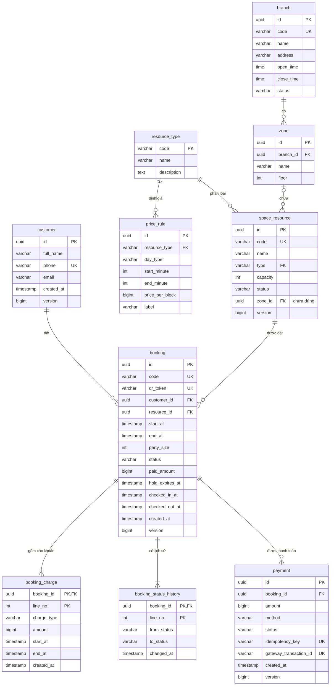
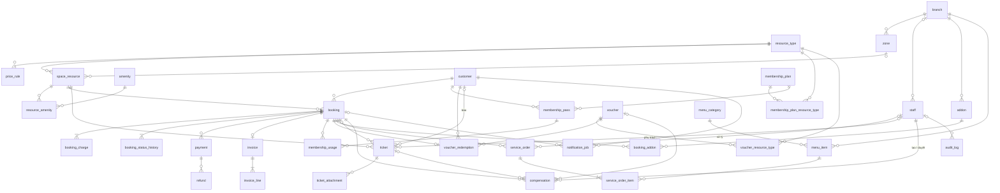

# Thiết Kế Cơ Sở Dữ Liệu
**Dự án:** Hệ thống đặt chỗ Co-Working Space theo giờ
**DBMS:** PostgreSQL 16+ (đang dùng 18)
**SQL tham khảo:** [`backend/db/schema.sql`](../backend/db/schema.sql) — bảng được tạo thủ công trong pgAdmin 4, xem [README mục 4.2](../README.md#42-tạo-database-và-bảng-trong-pgadmin-4)
**Tài liệu liên quan:** [SRS mục 5](SRS.md#5-yêu-cầu-dữ-liệu) · [State diagrams](diagrams.md#3-state-diagrams)

Có **35 bảng**, chia hai phần:
- **Phần 1 — 10 bảng** code đang dùng. **Bắt buộc** tạo trước khi chạy ứng dụng.
- **Phần 2 — 25 bảng** cho các chức năng sẽ làm sau. Code chưa dùng; tạo ngay hay để sau đều được.

---

## 1. Nguyên tắc thiết kế

**Chuẩn hóa — mỗi bảng chỉ mô tả một thứ.** Không dồn nhiều loại dữ liệu vào một bảng:

| Thay vì… | Thì tách thành… | Lý do |
| :--- | :--- | :--- |
| Lưu họ tên, SĐT, email ngay trong `booking` | Bảng `customer`, `booking.customer_id` trỏ tới | Một khách đặt nhiều lần; đổi email chỉ sửa một chỗ |
| Các cột `rental_amount`, `extension_amount`, `surcharge_amount` trong `booking` | Bảng `booking_charge`, mỗi khoản là một dòng | Gia hạn nhiều lần thì có nhiều dòng; biết rõ khoản nào tính cho khung giờ nào |
| Chỉ lưu trạng thái hiện tại của đơn | Thêm bảng `booking_status_history` | Tra được đơn đã đi qua những trạng thái nào, lúc nào |
| Lưu lặp `resource_type` trong `booking` | Lấy qua `booking.resource_id → space_resource.type` | Tránh hai nơi lưu cùng một thông tin rồi lệch nhau |
| Chữ `HOT_DESK`… không có mô tả | Bảng danh mục `resource_type` + khóa ngoại | Có tên tiếng Việt để hiển thị; không thể nhập sai mã |
| Cột mảng / JSON "các loại chỗ được áp dụng" | Bảng nối `voucher_resource_type`, `membership_plan_resource_type` | Truy vấn và ràng buộc khóa ngoại được |
| Đơn gọi món chứa luôn danh sách món | `service_order` (đầu đơn) + `service_order_item` (từng món) | Một đơn có nhiều món |
| Hóa đơn chứa luôn các dòng | `invoice` + `invoice_line` | Như trên |

**Quy ước:**

| Quy ước | Chi tiết |
| :--- | :--- |
| Tên bảng, tên cột | `snake_case`, số ít. Bảng chỗ ngồi tên `space_resource` để tránh trùng từ khóa `resource` |
| Khóa chính | `id uuid`, do ứng dụng sinh. Bảng con thuộc hẳn một đơn (`booking_charge`, `booking_status_history`) dùng khóa ghép `(booking_id, line_no)`. Bảng danh mục `resource_type` dùng chính mã làm khóa |
| Thời gian | `timestamp(6)` **không** kèm múi giờ; hiểu theo giờ `Asia/Ho_Chi_Minh` |
| Tiền | `bigint`, đơn vị **VND**, không có phần lẻ, luôn có `CHECK (... >= 0)` |
| Trạng thái | `varchar` + `CHECK (col IN (...))`, giá trị trùng tên enum Java. Thêm giá trị enum mới thì **phải** sửa `CHECK` |
| Khóa lạc quan | Cột `version bigint` trên bảng gốc của aggregate (`@Version` trong JPA) |
| Khoảng thời gian | Hai cột `start_at`, `end_at`, hiểu là nửa mở `[start_at, end_at)` |
| Tên ràng buộc | `pk_`, `fk_`, `uq_`, `ck_`, `ex_` (exclusion), `idx_` / `ux_` (index thường / index duy nhất) |
| Phân quyền | Bảng do tài khoản quản trị `postgres` tạo. Ứng dụng kết nối bằng user `cowork`, chỉ có quyền `SELECT, INSERT, UPDATE, DELETE, TRUNCATE` — không xóa / sửa cấu trúc bảng được |
| Cột chưa dùng trong code | Luôn cho phép rỗng hoặc có `DEFAULT`, để ứng dụng hiện tại vẫn ghi được |

## 2. Danh sách bảng

| # | Bảng | Nhóm | Chứa gì | Phần |
| :--- | :--- | :--- | :--- | :---: |
| 1 | `resource_type` | Không gian | Danh mục 5 loại chỗ (có sẵn dữ liệu) | 1 |
| 2 | `branch` | Không gian | Chi nhánh | 1 |
| 3 | `zone` | Không gian | Khu vực / tầng trong chi nhánh | 1 |
| 4 | `space_resource` | Không gian | Từng chỗ ngồi / phòng | 1 |
| 5 | `price_rule` | Giá | Giá một block theo loại chỗ × loại ngày × khung giờ | 1 |
| 6 | `customer` | Khách | Khách hàng, định danh bằng SĐT | 1 |
| 7 | `booking` | Đặt chỗ | Đơn đặt chỗ | 1 |
| 8 | `booking_charge` | Đặt chỗ | Các khoản tiền của đơn: thuê, gia hạn, phụ phí | 1 |
| 9 | `booking_status_history` | Đặt chỗ | Lịch sử đổi trạng thái của đơn | 1 |
| 10 | `payment` | Thanh toán | Giao dịch qua cổng thanh toán | 1 |
| 11 | `amenity` | Không gian | Danh mục tiện ích: ổ cắm, màn hình, yên tĩnh… | 2 |
| 12 | `resource_amenity` | Không gian | Chỗ nào có tiện ích nào, bao nhiêu | 2 |
| 13 | `staff` | Nhân sự | Nhân viên, vai trò, hạn mức đền bù | 2 |
| 14 | `membership_plan` | Thành viên | Các gói thành viên đang bán | 2 |
| 15 | `membership_plan_resource_type` | Thành viên | Gói dùng được cho loại chỗ nào | 2 |
| 16 | `membership_pass` | Thành viên | Gói khách đã mua, số phút còn lại | 2 |
| 17 | `membership_usage` | Thành viên | Mỗi lần trừ phút của gói cho một đơn | 2 |
| 18 | `voucher` | Khuyến mãi | Mã giảm giá và điều kiện | 2 |
| 19 | `voucher_resource_type` | Khuyến mãi | Voucher áp dụng cho loại chỗ nào | 2 |
| 20 | `voucher_redemption` | Khuyến mãi | Voucher đã dùng cho đơn nào | 2 |
| 21 | `addon` | Dịch vụ thuê kèm | Màn hình, máy chiếu… và số lượng có | 2 |
| 22 | `booking_addon` | Dịch vụ thuê kèm | Đơn thuê kèm những gì | 2 |
| 23 | `menu_category` | Đồ ăn uống | Nhóm món | 2 |
| 24 | `menu_item` | Đồ ăn uống | Món và giá | 2 |
| 25 | `service_order` | Đồ ăn uống | Đơn gọi món của khách đang ngồi | 2 |
| 26 | `service_order_item` | Đồ ăn uống | Từng món trong đơn gọi | 2 |
| 27 | `refund` | Tài chính | Yêu cầu hoàn tiền và kết quả | 2 |
| 28 | `invoice` | Tài chính | Hóa đơn | 2 |
| 29 | `invoice_line` | Tài chính | Từng dòng trong hóa đơn | 2 |
| 30 | `ticket` | Sự cố | Báo cáo sự cố cơ sở vật chất | 2 |
| 31 | `ticket_attachment` | Sự cố | Ảnh đính kèm sự cố | 2 |
| 32 | `compensation` | Sự cố | Đền bù cho khách | 2 |
| 33 | `notification_job` | Hạ tầng | Lịch gửi thông báo (nhắc lịch, cảnh báo hết giờ…) | 2 |
| 34 | `audit_log` | Hạ tầng | Nhật ký ai làm gì, khi nào | 2 |
| 35 | `outbox_event` | Hạ tầng | Event chờ phát (transactional outbox) | 2 |

## 3. Sơ đồ quan hệ (ERD)

### 3.1. Phần 1 — các bảng code đang dùng



### 3.2. Toàn bộ 35 bảng



`outbox_event` không có khóa ngoại: nó lưu event của mọi loại aggregate.

---

## 4. Chi tiết Phần 1 ✅

### 4.1. `resource_type` — danh mục loại chỗ
| Cột | Kiểu | Ràng buộc | Ghi chú |
| :--- | :--- | :--- | :--- |
| code | varchar(20) | PK | `HOT_DESK`, `FIXED_DESK`, `FOCUS_BOOTH`, `MEETING_ROOM`, `EVENT_SPACE` — trùng enum `ResourceType` trong Java |
| name | varchar(100) | NOT NULL | Tên tiếng Việt để hiển thị |
| description | text | | |

Phải **thêm sẵn 5 dòng** (câu `INSERT` có trong `schema.sql`), nếu không thì `space_resource` và `price_rule` không thêm được dữ liệu do vướng khóa ngoại.

### 4.2. `branch`, `zone` — chi nhánh, khu vực
Đã tạo để `space_resource.zone_id` có chỗ trỏ tới. Code chưa dùng; `zone_id` để trống được.

### 4.3. `space_resource` — chỗ ngồi / phòng
| Cột | Kiểu | Ràng buộc | Ghi chú |
| :--- | :--- | :--- | :--- |
| id | uuid | PK | |
| code | varchar(20) | NOT NULL, UNIQUE | Mã hiển thị trên sơ đồ |
| name | varchar(255) | NOT NULL | |
| type | varchar(20) | NOT NULL, FK → resource_type | |
| capacity | integer | NOT NULL, > 0 | Sức chứa (BR-14) |
| status | varchar(20) | NOT NULL, CHECK | `ACTIVE`, `MAINTENANCE`, `INACTIVE` (BR-09) |
| zone_id | uuid | FK → zone, cho phép rỗng | Chưa dùng trong code |
| version | bigint | | |

Mỗi lần giữ chỗ hoặc gia hạn, ứng dụng **khóa ghi** (`SELECT … FOR UPDATE`) dòng của chỗ đó. Nhờ vậy các yêu cầu trên cùng một chỗ được xử lý lần lượt từng cái.

### 4.4. `price_rule` — bảng giá
| Cột | Kiểu | Ràng buộc | Ghi chú |
| :--- | :--- | :--- | :--- |
| id | uuid | PK | |
| resource_type | varchar(20) | NOT NULL, FK → resource_type | |
| day_type | varchar(10) | NOT NULL, CHECK | `WEEKDAY`, `WEEKEND` |
| start_minute | integer | NOT NULL | Phút trong ngày, 540 = 09:00 |
| end_minute | integer | NOT NULL | Không tính phút này, 1440 = hết ngày |
| price_per_block | bigint | NOT NULL, ≥ 0 | VND một block (mặc định 30 phút) |
| label | varchar(50) | NOT NULL | "Cao điểm", "Thấp điểm sáng"… |

`ex_price_rule_no_overlap`: cùng loại chỗ, cùng loại ngày thì các khung giờ giá **không được chồng nhau**, nên mỗi thời điểm chỉ có một mức giá.

### 4.5. `customer` — khách hàng
| Cột | Kiểu | Ràng buộc | Ghi chú |
| :--- | :--- | :--- | :--- |
| id | uuid | PK | |
| full_name | varchar(255) | NOT NULL | |
| phone | varchar(15) | NOT NULL, UNIQUE | Định danh khách. Cùng SĐT = cùng một khách |
| email | varchar(255) | | |
| created_at | timestamp(6) | NOT NULL | |
| version | bigint | | |
| phone_verified_at | timestamp(6) | | Chưa dùng (UC01 xác thực OTP) |
| notify_before_minutes | integer | NOT NULL DEFAULT 15, CHECK 10/15/30 | Chưa dùng (UC12) |
| preferred_channel | varchar(10) | NOT NULL DEFAULT 'SMS' | Chưa dùng (UC12) |

Khách đặt chỗ lần đầu (kể cả khách vãng lai) được tự tạo một dòng. Lần sau đặt bằng cùng SĐT thì dùng lại dòng đó và cập nhật tên/email.

### 4.6. `booking` — đơn đặt chỗ
| Cột | Kiểu | Ràng buộc | Ghi chú |
| :--- | :--- | :--- | :--- |
| id | uuid | PK | |
| code | varchar(12) | NOT NULL, UNIQUE | Mã đơn cho khách, ví dụ `BK7Q2M9XKA` |
| qr_token | varchar(64) | NOT NULL, UNIQUE | Nội dung mã QR, ngẫu nhiên 256 bit |
| customer_id | uuid | NOT NULL, FK → customer | |
| resource_id | uuid | NOT NULL, FK → space_resource | |
| start_at, end_at | timestamp(6) | NOT NULL, `end_at > start_at` | `end_at` lùi ra sau mỗi lần gia hạn |
| party_size | integer | NOT NULL, > 0 | |
| status | varchar(20) | NOT NULL, CHECK | 12 trạng thái, xem State Diagram 3.1 |
| paid_amount | bigint | NOT NULL DEFAULT 0, ≥ 0 | Đã thu. Còn nợ = tổng `booking_charge.amount` − `paid_amount` |
| hold_expires_at | timestamp(6) | | Hạn giữ chỗ (BR-02) |
| checked_in_at, checked_out_at | timestamp(6) | | Giờ vào / ra thực tế |
| created_at | timestamp(6) | NOT NULL | |
| version | bigint | | |

**Ràng buộc quan trọng nhất — `ex_booking_no_overlap` (BR-01):**
```sql
EXCLUDE USING gist (resource_id WITH =, tsrange(start_at, end_at) WITH &&)
WHERE (status IN ('HELD', 'CONFIRMED', 'CHECKED_IN', 'OVERSTAY'))
```
Database **từ chối** mọi đơn đang hiệu lực có cùng chỗ và khung giờ giao nhau. Code đã chặn trước bằng cách khóa dòng `space_resource`; ràng buộc này là lớp bảo vệ cuối cùng. Cần extension `btree_gist`.

| Index | Phục vụ |
| :--- | :--- |
| `ex_booking_no_overlap` (gist) | Ngoài vai trò ràng buộc, còn làm nhanh truy vấn tìm chỗ trống (UC02) |
| `idx_booking_customer` | Xem các đơn của một khách |
| `idx_booking_hold_expiry` (chỉ các dòng `status = 'HELD'`) | Job giải phóng chỗ hết hạn giữ (UC24) |
| `idx_booking_checked_in_end` (chỉ các dòng `status = 'CHECKED_IN'`) | Job đánh dấu quá giờ (UC24) |

### 4.7. `booking_charge` — các khoản tiền của đơn
| Cột | Kiểu | Ràng buộc | Ghi chú |
| :--- | :--- | :--- | :--- |
| booking_id | uuid | PK, FK → booking (xóa đơn thì xóa theo) | |
| line_no | integer | PK | Thứ tự dòng, bắt đầu từ 0 |
| charge_type | varchar(30) | NOT NULL, CHECK | `RENTAL` (tiền thuê), `EXTENSION` (gia hạn), `OVERSTAY_SURCHARGE` (phụ phí quá giờ) |
| amount | bigint | NOT NULL, ≥ 0 | |
| start_at, end_at | timestamp(6) | NOT NULL | Khoảng thời gian mà khoản này tính tiền |
| created_at | timestamp(6) | NOT NULL | |

Ví dụ một đơn 09:00–11:00, gia hạn tới 11:30, ra lúc 11:50:

| line_no | charge_type | amount | start_at | end_at |
| :---: | :--- | ---: | :--- | :--- |
| 0 | RENTAL | 600 000 | 09:00 | 11:00 |
| 1 | EXTENSION | 150 000 | 11:00 | 11:30 |
| 2 | OVERSTAY_SURCHARGE | 150 000 | 11:30 | 11:50 |

### 4.8. `booking_status_history` — lịch sử trạng thái
| Cột | Kiểu | Ràng buộc | Ghi chú |
| :--- | :--- | :--- | :--- |
| booking_id | uuid | PK, FK → booking (xóa đơn thì xóa theo) | |
| line_no | integer | PK | |
| from_status | varchar(20) | | Rỗng ở lần tạo đơn |
| to_status | varchar(20) | NOT NULL | |
| changed_at | timestamp(6) | NOT NULL | |

### 4.9. `payment` — giao dịch thanh toán
| Cột | Kiểu | Ràng buộc | Ghi chú |
| :--- | :--- | :--- | :--- |
| id | uuid | PK | |
| booking_id | uuid | NOT NULL, FK → booking | |
| amount | bigint | NOT NULL, > 0 | |
| method | varchar(20) | NOT NULL, CHECK | `VIETQR`, `E_WALLET`, `CARD` |
| status | varchar(20) | NOT NULL, CHECK | Xem State Diagram 3.3 |
| idempotency_key | varchar(80) | NOT NULL, UNIQUE | Gửi cho cổng để không tạo giao dịch trùng (FR-PAY-02) |
| gateway_transaction_id | varchar(80) | UNIQUE | Mã giao dịch phía cổng; webhook tìm theo cột này |
| checkout_url | varchar(255) | | |
| created_at, completed_at | timestamp(6) | created_at NOT NULL | |
| version | bigint | | |

`ux_payment_open_per_booking` (index duy nhất, chỉ trên các dòng `status IN ('INITIATED','PENDING')`): mỗi đơn chỉ có **một** giao dịch đang mở.

---

## 5. Phần 2 — tóm tắt 🕓

Chi tiết từng cột và ràng buộc xem trực tiếp trong `schema.sql` (mỗi cột có chú thích). Một số điểm cần biết khi bắt tay làm:

| Nhóm | Điểm cần chú ý |
| :--- | :--- |
| Thành viên | `membership_usage.status` = `HELD` khi đơn đang giữ chỗ; trả lại phút (`RELEASED`) nếu đơn hết hạn hoặc thất bại |
| Voucher | `voucher_redemption.booking_id` UNIQUE → mỗi đơn tối đa một voucher (BR-12). Không có dòng nào trong `voucher_resource_type` = áp dụng cho mọi loại chỗ |
| Đồ ăn uống | `menu_item.is_drink` + `service_order_item.is_free_drink` để áp cốc nước miễn phí đầu tiên (BR-10) |
| Sự cố | `ticket.priority = 'HIGH'` cho sự cố mạng (FR-SVC-03). `compensation.approved_by` có giá trị khi vượt `staff.compensation_limit` (BR-18) |
| Hạ tầng | `notification_job` có index trên các lịch chưa gửi để job quét nhanh. `audit_log` chỉ thêm, không sửa, không xóa |

## 6. Quy trình thay đổi cấu trúc bảng

1. Mở pgAdmin (tài khoản `postgres`) → database `working-space` → *Tools → Query Tool*. Bảng tạo mới tự cấp quyền cho `cowork` nhờ câu `ALTER DEFAULT PRIVILEGES` trong `schema.sql`.
2. Chạy SQL (`CREATE TABLE`, `ALTER TABLE ...`) theo thiết kế trong tài liệu này. Cập nhật luôn tài liệu này nếu thiết kế thay đổi.
3. Chép câu SQL vừa chạy vào cuối `backend/db/schema.sql`, kèm chú thích ngày và lý do.
4. Sửa/tạo entity Java cho khớp. Ứng dụng chạy với `ddl-auto: validate`: nếu entity và bảng lệch nhau, ứng dụng **báo lỗi ngay khi khởi động** — đó là tín hiệu tốt, không phải sự cố.
5. Mọi máy (của từng người, máy test, server) đều phải chạy cùng các câu SQL đó. Khi dự án có nhiều người hoặc có server production, nên chuyển sang công cụ migration (Flyway/Liquibase) để việc này tự động.
