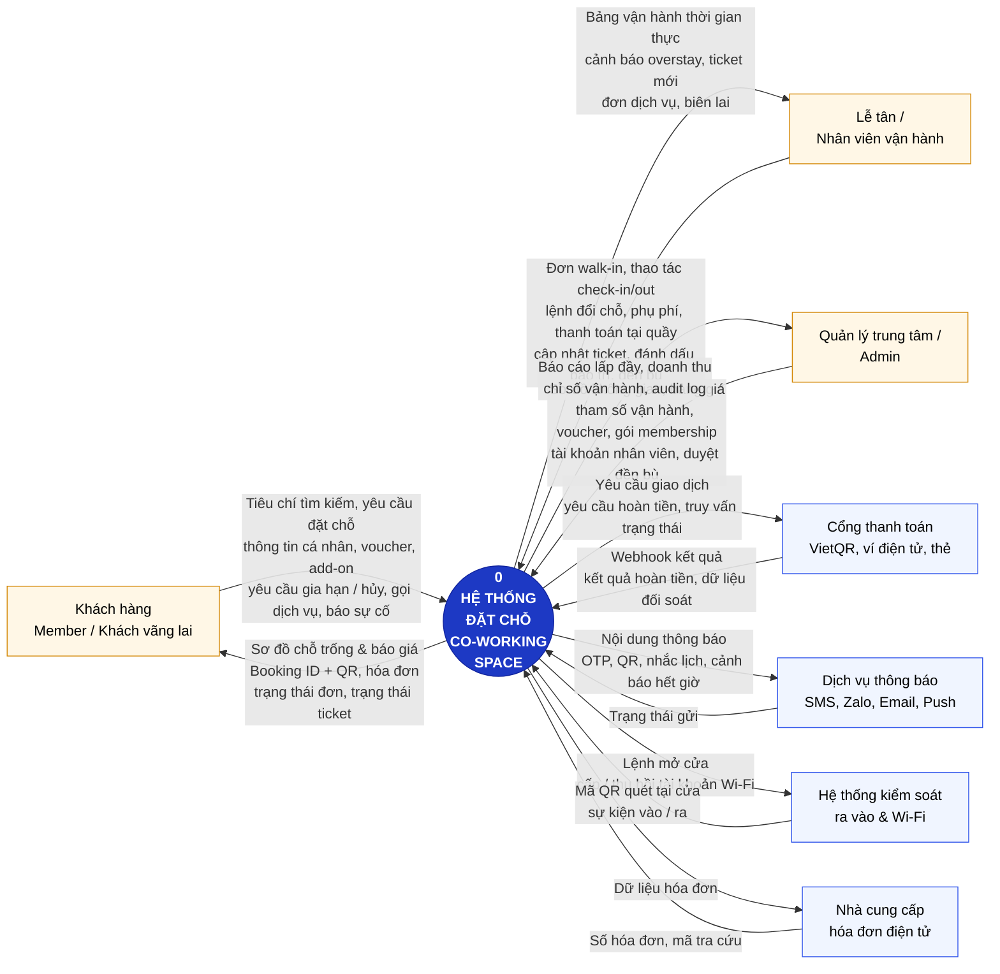
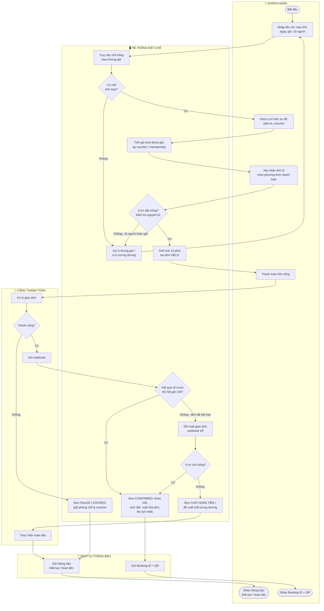
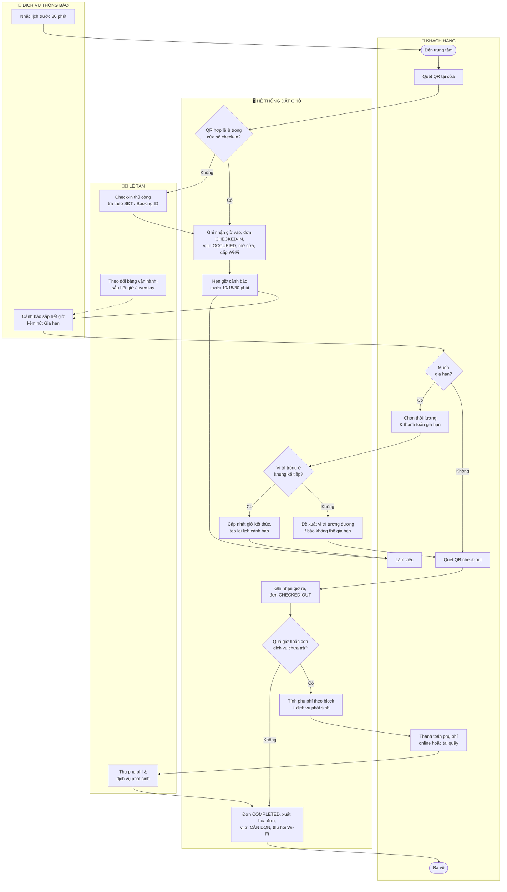
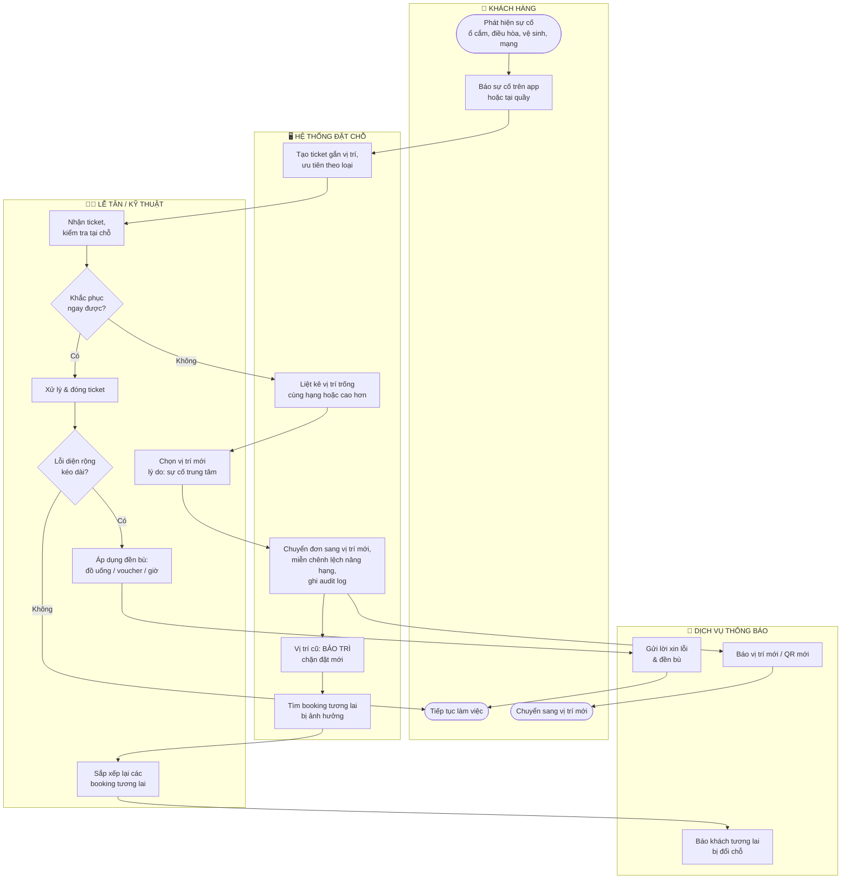
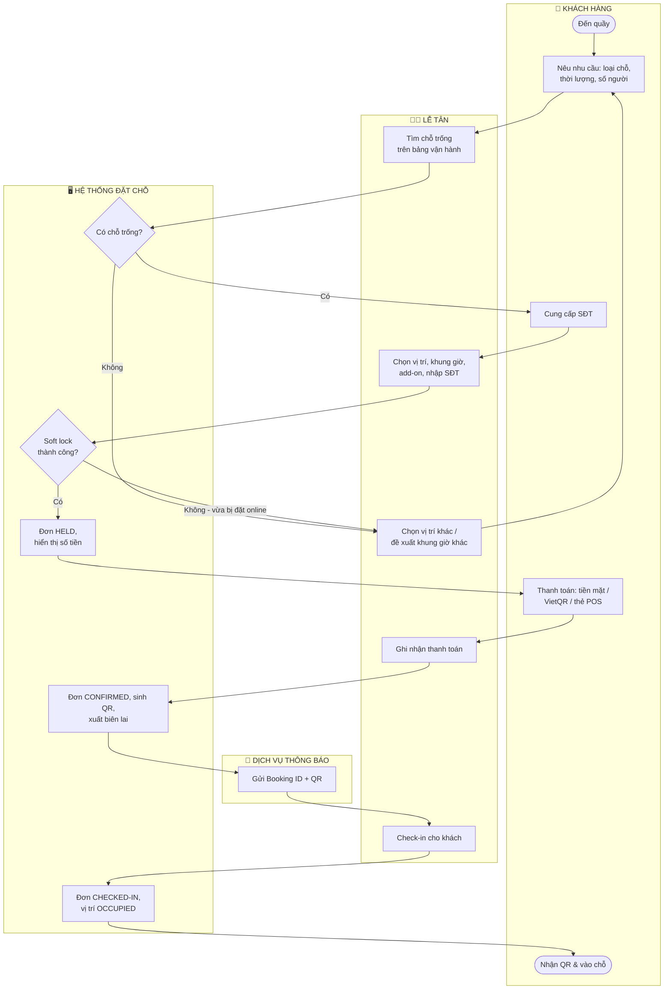
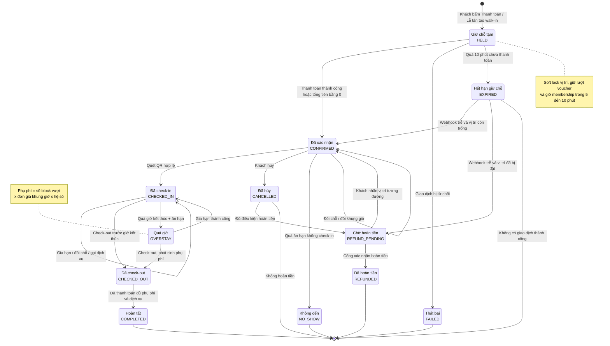
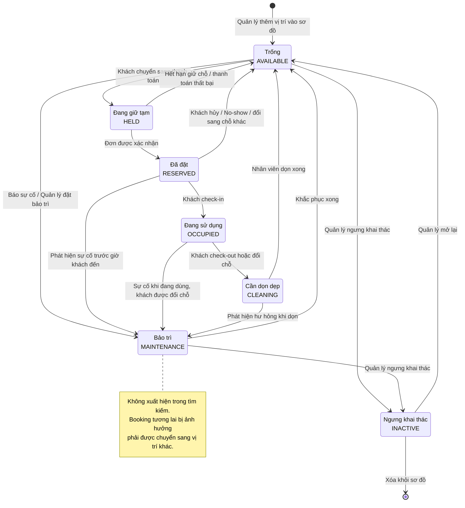
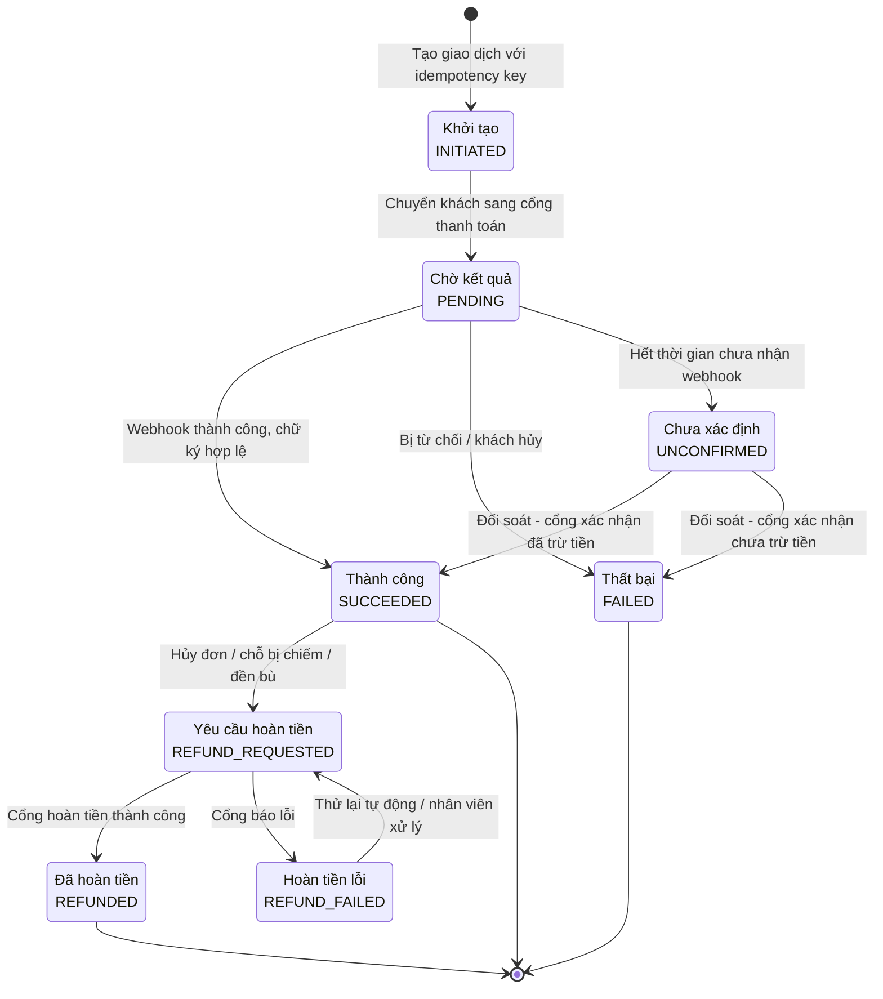
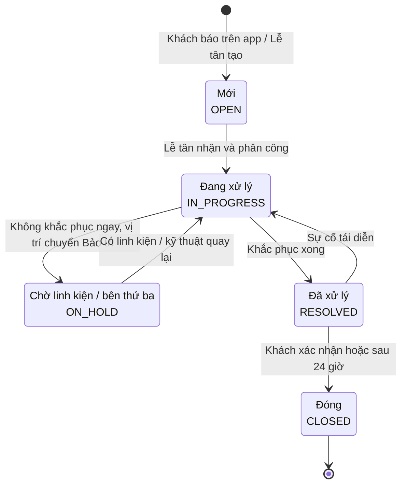

# Các Sơ Đồ Phân Tích Hệ Thống
**Dự án:** Hệ thống đặt chỗ Co-Working Space theo giờ
**Tài liệu liên quan:** [SRS](SRS.md) · [Đặc tả Use Case](use-cases.md) (gồm sơ đồ Use Case)

Mục lục:
1. [Context Diagram](#1-context-diagram)
2. [Swimlane Diagrams](#2-swimlane-diagrams)
3. [State Diagrams](#3-state-diagrams)

---

## 1. Context Diagram

Sơ đồ ngữ cảnh mức 0: toàn bộ hệ thống là một tiến trình duy nhất, xung quanh là các thực thể ngoài và luồng dữ liệu trao đổi.

| Thực thể ngoài | Dữ liệu vào hệ thống | Dữ liệu ra từ hệ thống |
| :--- | :--- | :--- |
| Khách hàng | Tiêu chí tìm, yêu cầu đặt/gia hạn/hủy, thông tin cá nhân, voucher, add-on, đơn dịch vụ, báo sự cố | Sơ đồ & giá, Booking ID + QR, hóa đơn, trạng thái đơn/ticket |
| Lễ tân | Đơn walk-in, check-in/out, đổi chỗ, phụ phí, thanh toán tại quầy, ticket, bảo trì, đền bù | Bảng vận hành, cảnh báo, đơn dịch vụ, biên lai |
| Quản lý | Cấu hình sơ đồ, bảng giá, tham số, khuyến mãi, nhân viên, phê duyệt | Báo cáo, audit log |
| Cổng thanh toán | Webhook, kết quả hoàn tiền, dữ liệu đối soát | Yêu cầu giao dịch, hoàn tiền, truy vấn |
| Dịch vụ thông báo | Trạng thái gửi | OTP, QR, nhắc lịch, cảnh báo |
| Kiểm soát ra vào / Wi-Fi | QR quét, sự kiện vào/ra | Lệnh mở cửa, cấp/thu hồi Wi-Fi |
| Hóa đơn điện tử | Số hóa đơn, mã tra cứu | Dữ liệu hóa đơn |

---

## 2. Swimlane Diagrams

Mỗi làn (lane) là một khung tương ứng với một tác nhân; hình thoi là điểm quyết định.

### 2.1. Đặt chỗ & thanh toán trực tuyến (gồm xử lý race condition và lỗi cổng thanh toán)

### 2.2. Check-in → Sử dụng → Gia hạn → Check-out

### 2.3. Xử lý sự cố cơ sở vật chất & đổi chỗ

### 2.4. Đặt chỗ walk-in tại quầy

---

## 3. State Diagrams

### 3.1. Vòng đời Đơn đặt chỗ (Booking)

| Trạng thái | Ý nghĩa | Vị trí bị chiếm? |
| :--- | :--- | :---: |
| HELD | Đang giữ chỗ chờ thanh toán | Có (tạm) |
| CONFIRMED | Đã thanh toán, chờ khách đến | Có |
| CHECKED_IN | Khách đang sử dụng | Có |
| OVERSTAY | Quá giờ, chưa check-out | Có |
| CHECKED_OUT | Đã ra, còn khoản chưa thanh toán | Không |
| COMPLETED | Kết thúc, đã thanh toán đủ | Không |
| FAILED / EXPIRED / CANCELLED / NO_SHOW | Kết thúc không sử dụng | Không |
| REFUND_PENDING / REFUNDED | Đang hoàn / đã hoàn tiền | Không |

### 3.2. Trạng thái Vị trí (Resource) theo khung giờ

> Trạng thái HELD / RESERVED / OCCUPIED được xác định **theo từng khung giờ** (suy ra từ các booking), còn MAINTENANCE / INACTIVE là trạng thái của bản thân vị trí, áp dụng cho mọi khung giờ trong thời gian hiệu lực.

### 3.3. Trạng thái Giao dịch thanh toán (Payment)

### 3.4. Trạng thái Ticket sự cố

