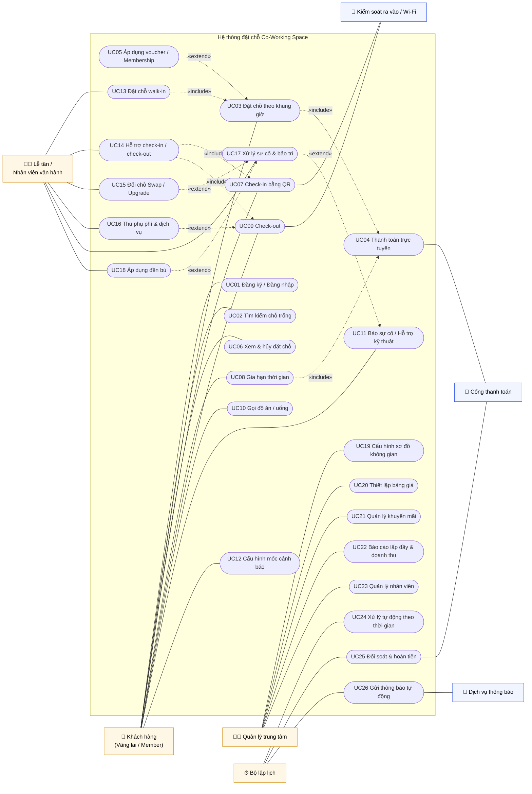
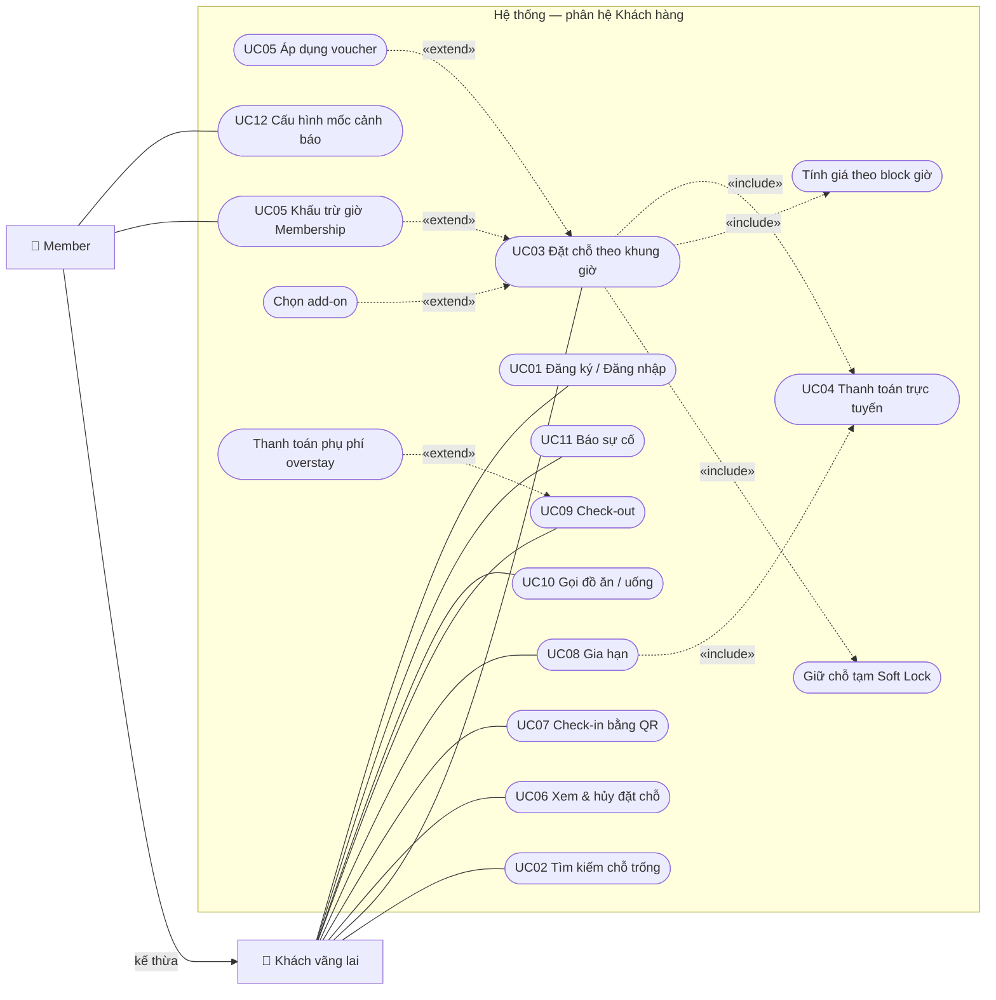

# Đặc Tả Use Case
**Dự án:** Hệ thống đặt chỗ Co-Working Space theo giờ
**Phiên bản:** 1.0 — 28/10/2026
**Tài liệu liên quan:** [SRS](SRS.md) · [Các sơ đồ](diagrams.md)

---

## 1. Danh sách Actor

| Actor | Loại | Mô tả |
| :--- | :--- | :--- |
| Khách hàng | Chính | Gồm *Khách vãng lai* và *Thành viên (Member)*. Member kế thừa toàn bộ use case của khách vãng lai |
| Lễ tân / Nhân viên vận hành | Chính | Vận hành tại quầy, bao gồm nhân viên kỹ thuật xử lý sự cố |
| Quản lý trung tâm / Admin | Chính | Cấu hình hệ thống, giám sát kinh doanh |
| Cổng thanh toán | Phụ (hệ thống) | Xử lý giao dịch, webhook, hoàn tiền |
| Dịch vụ thông báo | Phụ (hệ thống) | SMS / Zalo / Email / Push |
| Hệ thống kiểm soát ra vào / Wi-Fi | Phụ (hệ thống) | Mở cửa bằng QR, cấp tài khoản Wi-Fi |
| Bộ lập lịch (Timer) | Chính (thời gian) | Kích hoạt các tác vụ tự động theo thời gian |

## 2. Danh sách Use Case

| ID | Tên Use Case | Actor chính | Mức ưu tiên |
| :--- | :--- | :--- | :---: |
| UC01 | Đăng ký / Đăng nhập & quản lý hồ sơ | Khách hàng | M |
| UC02 | Tìm kiếm chỗ trống | Khách hàng | M |
| UC03 | Đặt chỗ theo khung giờ | Khách hàng | M |
| UC04 | Thanh toán trực tuyến | Khách hàng | M |
| UC05 | Áp dụng voucher / Membership | Khách hàng | M |
| UC06 | Xem & hủy đặt chỗ | Khách hàng | M |
| UC07 | Check-in bằng QR | Khách hàng | M |
| UC08 | Gia hạn thời gian sử dụng | Khách hàng | M |
| UC09 | Check-out | Khách hàng | M |
| UC10 | Gọi dịch vụ đồ ăn / thức uống | Khách hàng | S |
| UC11 | Báo sự cố / Yêu cầu hỗ trợ kỹ thuật | Khách hàng | M |
| UC12 | Cấu hình mốc cảnh báo hết giờ | Khách hàng (Member) | S |
| UC13 | Đặt chỗ walk-in tại quầy | Lễ tân | M |
| UC14 | Hỗ trợ check-in / check-out tại quầy | Lễ tân | M |
| UC15 | Đổi chỗ (Swap / Upgrade) | Lễ tân | M |
| UC16 | Thu phụ phí & dịch vụ phát sinh | Lễ tân | M |
| UC17 | Xử lý sự cố & đánh dấu bảo trì | Lễ tân | M |
| UC18 | Áp dụng đền bù | Lễ tân | S |
| UC19 | Cấu hình sơ đồ không gian & danh mục | Quản lý | M |
| UC20 | Thiết lập bảng giá & tham số vận hành | Quản lý | M |
| UC21 | Quản lý khuyến mãi, voucher & gói Membership | Quản lý | M |
| UC22 | Xem báo cáo lấp đầy & doanh thu | Quản lý | M |
| UC23 | Quản lý tài khoản nhân viên & phân quyền | Quản lý | M |
| UC24 | Xử lý tự động theo thời gian (hết hạn giữ chỗ, overstay, no-show) | Bộ lập lịch | M |
| UC25 | Đối soát thanh toán & hoàn tiền | Bộ lập lịch / Cổng thanh toán | M |
| UC26 | Gửi thông báo tự động | Bộ lập lịch | M |

---

## 3. Sơ đồ Use Case

> Mermaid chưa có ký pháp use case riêng nên sơ đồ được biểu diễn bằng flowchart: hình chữ nhật bo tròn là use case, khung lớn là ranh giới hệ thống, mũi tên nét đứt là quan hệ «include»/«extend».

### 3.1. Tổng quan

### 3.2. Phân rã theo Actor — Khách hàng

---

## 4. Đặc tả chi tiết Use Case

### UC01 — Đăng ký / Đăng nhập & quản lý hồ sơ
| Mục | Nội dung |
| :--- | :--- |
| Actor chính | Khách hàng |
| Actor phụ | Dịch vụ thông báo (gửi OTP) |
| Mô tả | Khách tạo tài khoản Member, đăng nhập và quản lý hồ sơ, xem số giờ Membership còn lại. |
| Tiền điều kiện | Khách có SĐT hoặc Email hợp lệ. |
| Hậu điều kiện | Tài khoản được tạo/đăng nhập; các đơn vãng lai cùng SĐT được liên kết vào tài khoản. |
| Kích hoạt | Khách chọn "Đăng ký" / "Đăng nhập". |

**Luồng chính**
1. Khách nhập SĐT (hoặc Email).
2. Hệ thống gửi OTP qua Dịch vụ thông báo.
3. Khách nhập OTP.
4. Hệ thống xác thực OTP; nếu SĐT chưa có tài khoản, yêu cầu nhập Họ tên, Email và đồng ý điều khoản xử lý dữ liệu cá nhân.
5. Hệ thống tạo/đăng nhập tài khoản, liên kết đơn vãng lai cùng SĐT (FR-AUTH-03).
6. Hệ thống hiển thị trang hồ sơ: thông tin cá nhân, gói Membership, lịch sử đặt chỗ.

**Luồng thay thế**
- 3a. Khách yêu cầu gửi lại OTP: hệ thống chỉ cho phép sau 60 giây, tối đa 5 lần/giờ.

**Ngoại lệ**
- 4a. OTP sai/hết hạn: báo lỗi; sai 5 lần liên tiếp → khóa đăng nhập 15 phút.

**Yêu cầu liên quan:** FR-AUTH-02, 03, 05; NFR-08, NFR-09.

---

### UC02 — Tìm kiếm chỗ trống
| Mục | Nội dung |
| :--- | :--- |
| Actor chính | Khách hàng (cũng được Lễ tân dùng trong UC13) |
| Mô tả | Khách tìm vị trí còn trống theo loại không gian, thời gian, số người và xem trên sơ đồ. |
| Tiền điều kiện | Có ít nhất một chi nhánh đang hoạt động. |
| Hậu điều kiện | Khách thấy danh sách/sơ đồ vị trí khả dụng kèm giá dự kiến. Không thay đổi dữ liệu. |
| Kích hoạt | Khách mở màn hình "Đặt chỗ". |

**Luồng chính**
1. Khách chọn chi nhánh, loại không gian (Hot Desk / Fixed Desk / Focus Booth / Meeting Room / Event Space).
2. Khách chọn ngày, giờ bắt đầu và giờ kết thúc (hoặc số giờ), số người.
3. Hệ thống kiểm tra dữ liệu: giờ kết thúc > giờ bắt đầu, nằm trong giờ mở cửa, không ở quá khứ, thời lượng ≥ tối thiểu.
4. Hệ thống truy vấn vị trí có sức chứa phù hợp, không ở trạng thái Bảo trì/Ngưng khai thác, không có đơn hiệu lực giao khung giờ (BR-01, BR-09, BR-14).
5. Hệ thống hiển thị sơ đồ mặt bằng với mã màu trạng thái và giá dự kiến cho từng vị trí (BR-03, BR-04).
6. Khách xem chi tiết vị trí (tiện ích, số ổ cắm, ảnh) và chọn vị trí → chuyển sang UC03.

**Luồng thay thế**
- 2a. Khách lọc thêm theo tiện ích (yên tĩnh, ổ cắm, màn hình…).
- 6a. Hot Desk: khách chọn "Tự gán" → hệ thống chọn vị trí phù hợp nhất.

**Ngoại lệ**
- 3a. Dữ liệu không hợp lệ → báo lỗi tại trường tương ứng.
- 4a. Không còn vị trí phù hợp → hệ thống gợi ý khung giờ lân cận hoặc loại không gian tương đương (FR-SRCH-05).

**Yêu cầu liên quan:** FR-SRCH-01..06.

---

### UC03 — Đặt chỗ theo khung giờ
| Mục | Nội dung |
| :--- | :--- |
| Actor chính | Khách hàng |
| Actor phụ | Cổng thanh toán (qua UC04), Dịch vụ thông báo |
| Mô tả | Khách xác nhận vị trí, khung giờ, add-on, thông tin liên hệ; hệ thống giữ chỗ tạm và chuyển sang thanh toán. |
| Tiền điều kiện | Khách đã chọn vị trí trống ở UC02. |
| Hậu điều kiện thành công | Đơn ở trạng thái **Confirmed**, vị trí bị khóa theo khung giờ, khách nhận Booking ID + QR. |
| Hậu điều kiện thất bại | Đơn ở trạng thái **Failed/Expired**, vị trí & lượt voucher được giải phóng. |
| Kích hoạt | Khách bấm "Đặt chỗ" trên vị trí đã chọn. |

**Luồng chính**
1. Hệ thống hiển thị tóm tắt: vị trí, ngày, giờ, số người, giá thuê theo block.
2. Khách chọn add-on (màn hình, máy chiếu, bảng trắng, suất ăn/uống) — *extension point: Chọn add-on*.
3. Khách nhập/xác nhận Họ tên, SĐT, Email (Member được điền sẵn).
4. Khách nhập voucher hoặc chọn dùng giờ Membership — *extension point: UC05*.
5. Hệ thống tính tổng tiền chi tiết (FR-BOOK-06) và hiển thị.
6. Khách chọn phương thức thanh toán và bấm "Thanh toán".
7. Hệ thống thực hiện **soft lock** trong một giao dịch nguyên tử: kiểm tra lại xung đột, tạo đơn **Held** với `hold_expires_at = now + 10 phút` (BR-02), giữ lượt voucher, giữ add-on.
8. Hệ thống hiển thị đồng hồ đếm ngược và chuyển sang **UC04 Thanh toán trực tuyến**.
9. Khi UC04 thành công: hệ thống chuyển đơn **Confirmed**, sinh Booking ID + QR, xuất hóa đơn/biên lai (hoặc khấu trừ giờ Membership), tạo lịch thông báo (UC26).
10. Hệ thống hiển thị màn hình đặt chỗ thành công với QR.

**Luồng thay thế**
- 4a. Tổng tiền = 0 (dùng toàn bộ giờ Membership/voucher 100%): bỏ qua bước 6–8, đơn chuyển thẳng **Confirmed** ở bước 9.
- 6a. Khách quay lại chỉnh sửa trước khi thanh toán: chưa tạo soft lock, quay về bước 1.

**Ngoại lệ**
- 7a. **Race condition** — vị trí vừa bị người khác giữ: hệ thống báo "Vị trí vừa được đặt", gợi ý vị trí tương đương còn trống (quay lại UC02).
- 7b. Add-on hết trong khung giờ: báo khách, cho phép bỏ add-on và tiếp tục.
- 8a. Hết thời gian giữ chỗ trước khi thanh toán xong: UC24 chuyển đơn **Expired**, giải phóng vị trí; khách được thông báo.
- 9a. Thanh toán thất bại: đơn **Failed**, giải phóng vị trí, khách có thể thử lại (tạo soft lock mới).

**Quy tắc:** BR-01, BR-02, BR-03, BR-04, BR-12, BR-13, BR-14.
**Yêu cầu liên quan:** FR-BOOK-01..06, FR-AUTH-01, FR-PAY-04, 05.

---

### UC04 — Thanh toán trực tuyến
| Mục | Nội dung |
| :--- | :--- |
| Actor chính | Khách hàng |
| Actor phụ | Cổng thanh toán |
| Mô tả | Thanh toán số tiền của đơn (đặt mới hoặc gia hạn/phụ phí) qua cổng thanh toán. |
| Tiền điều kiện | Có đơn/khoản phải thu ở trạng thái chờ thanh toán, còn trong thời gian giữ chỗ. |
| Hậu điều kiện | Giao dịch **Succeeded** và đơn được cập nhật; hoặc **Failed** và đơn được giải phóng. |
| Kích hoạt | Bước 8 của UC03, UC08 hoặc UC09. |

**Luồng chính**
1. Hệ thống tạo giao dịch với mã idempotency, số tiền, thời hạn = thời hạn giữ chỗ.
2. Hệ thống chuyển khách tới cổng (redirect / hiển thị VietQR / mở ví điện tử).
3. Khách xác nhận thanh toán trên cổng.
4. Cổng thanh toán xử lý và gửi **webhook** kết quả.
5. Hệ thống xác thực chữ ký webhook, kiểm tra idempotency, đối chiếu số tiền.
6. Hệ thống ghi nhận giao dịch **Succeeded** và trả kết quả cho use case gọi.

**Luồng thay thế**
- 4a. Khách quay về ứng dụng trước khi có webhook: hệ thống hiển thị "Đang xác nhận", chủ động truy vấn trạng thái giao dịch.
- 5a. Webhook trùng lặp: bỏ qua, không xử lý lại.

**Ngoại lệ**
- 4b. Giao dịch bị từ chối/khách hủy: giao dịch **Failed**, trả kết quả thất bại.
- 4c. Không nhận được webhook trong thời hạn: giao dịch **Unconfirmed**, chuyển cho UC25 đối soát.
- 5b. Chữ ký không hợp lệ hoặc sai số tiền: từ chối webhook, ghi log cảnh báo bảo mật.

**Yêu cầu liên quan:** FR-PAY-01..05.

---

### UC05 — Áp dụng voucher / Membership
| Mục | Nội dung |
| :--- | :--- |
| Actor chính | Khách hàng |
| Mô tả | Mở rộng của UC03/UC13: giảm giá bằng voucher hoặc khấu trừ giờ từ gói Membership. |
| Tiền điều kiện | Đang ở bước xác nhận đơn. Với Membership: khách đã đăng nhập và có gói còn hạn. |
| Hậu điều kiện | Tổng tiền được cập nhật; lượt voucher/giờ gói được giữ tạm theo đơn. |

**Luồng chính (voucher)**
1. Khách nhập mã voucher.
2. Hệ thống kiểm tra: tồn tại, còn hạn, còn tổng lượt và lượt/khách, thỏa điều kiện loại không gian/khung giờ/giá trị tối thiểu (BR-12).
3. Hệ thống tính lại tổng tiền, hiển thị số tiền giảm.

**Luồng thay thế (Membership)**
- 1a. Khách bật "Dùng giờ Membership" → hệ thống khấu trừ tối đa số giờ còn lại hợp lệ cho loại không gian (BR-13), phần còn lại tính tiền.

**Ngoại lệ**
- 2a. Voucher không hợp lệ → hiển thị lý do cụ thể (hết hạn / hết lượt / không áp dụng cho loại chỗ…).
- 2b. Đơn hết hạn/thất bại → hoàn lại lượt voucher và giờ Membership đã giữ (FR-PROMO-03).

**Yêu cầu liên quan:** FR-PROMO-01..03.

---

### UC06 — Xem & hủy đặt chỗ
| Mục | Nội dung |
| :--- | :--- |
| Actor chính | Khách hàng |
| Actor phụ | Cổng thanh toán (hoàn tiền), Dịch vụ thông báo |
| Mô tả | Khách xem danh sách đơn, chi tiết, QR; hủy đơn chưa check-in. |
| Tiền điều kiện | Member đã đăng nhập; khách vãng lai tra cứu bằng Booking ID + SĐT (xác thực OTP). |
| Hậu điều kiện | Đơn hủy → **Cancelled**, vị trí được giải phóng, khoản hoàn (nếu có) được tạo, lịch thông báo bị hủy. |

**Luồng chính**
1. Khách mở "Đơn của tôi"; hệ thống hiển thị danh sách theo trạng thái (Sắp tới / Đang dùng / Đã xong / Đã hủy).
2. Khách chọn một đơn Confirmed và bấm "Hủy".
3. Hệ thống tính số tiền hoàn theo chính sách hủy (BR-15) và hiển thị.
4. Khách xác nhận hủy.
5. Hệ thống chuyển đơn **Cancelled**, giải phóng vị trí, hủy lịch thông báo, tạo yêu cầu hoàn tiền (UC25) hoặc trả giờ Membership.
6. Hệ thống gửi thông báo xác nhận hủy.

**Luồng thay thế**
- 2a. Khách chỉ xem chi tiết/QR: kết thúc ở bước 1.
- 3a. Không đủ điều kiện hoàn: hiển thị "Không hoàn tiền", khách vẫn có thể hủy.

**Ngoại lệ**
- 2b. Đơn đã check-in: không cho hủy, hướng dẫn check-out (UC09).

**Yêu cầu liên quan:** FR-BOOK-07..09.

---

### UC07 — Check-in bằng QR
| Mục | Nội dung |
| :--- | :--- |
| Actor chính | Khách hàng |
| Actor phụ | Hệ thống kiểm soát ra vào / Wi-Fi |
| Mô tả | Khách quét QR tại cửa hoặc quầy để bắt đầu sử dụng. |
| Tiền điều kiện | Đơn **Confirmed**, trong cửa sổ check-in (BR-17). |
| Hậu điều kiện | Đơn **CheckedIn** với mốc thời gian thực; vị trí **Occupied**; cửa mở; Wi-Fi được cấp. |
| Kích hoạt | Khách đưa QR vào máy quét. |

**Luồng chính**
1. Khách quét QR tại cửa kiểm soát.
2. Hệ thống kiểm tra QR: hợp lệ, đúng chi nhánh, đơn Confirmed, trong cửa sổ check-in, vị trí không bị chiếm.
3. Hệ thống ghi nhận `check_in_at`, chuyển đơn **CheckedIn**, vị trí **Occupied**.
4. Hệ thống gửi lệnh mở cửa và cấp tài khoản Wi-Fi gắn với đơn.
5. Hệ thống hiển thị trên app: vị trí, giờ kết thúc, đồng hồ thời gian còn lại, quyền cốc nước miễn phí (BR-10).

**Luồng thay thế**
- 1a. Check-in tại quầy qua Lễ tân (UC14).

**Ngoại lệ**
- 2a. QR không hợp lệ/đã dùng/sai chi nhánh → từ chối, hướng dẫn tới quầy.
- 2b. Đến quá sớm → báo thời điểm sớm nhất được check-in.
- 2c. Đơn đã No-show → từ chối, Lễ tân có thể tạo đơn mới (UC13).
- 2d. Vị trí gặp sự cố/đang bảo trì → chuyển sang UC15 Đổi chỗ.
- 4a. Hệ thống cửa không phản hồi → thông báo khách tới quầy; Lễ tân check-in thủ công.

**Yêu cầu liên quan:** FR-CHK-01..03.

---

### UC08 — Gia hạn thời gian sử dụng
| Mục | Nội dung |
| :--- | :--- |
| Actor chính | Khách hàng |
| Actor phụ | Cổng thanh toán |
| Mô tả | Khách đang sử dụng muốn ngồi thêm sau giờ kết thúc đã đăng ký. |
| Tiền điều kiện | Đơn **CheckedIn** hoặc **Overstay**. |
| Hậu điều kiện | Giờ kết thúc được cập nhật, khoản gia hạn được thanh toán, lịch cảnh báo được tạo lại. |
| Kích hoạt | Khách bấm "Gia hạn" trên app hoặc trong thông báo sắp hết giờ. |

**Luồng chính**
1. Khách chọn thời lượng gia hạn (theo block).
2. Hệ thống kiểm tra vị trí hiện tại trống trong khoảng gia hạn (BR-07).
3. Hệ thống tính giá theo bảng giá khung giờ tương ứng và hiển thị.
4. Khách xác nhận; hệ thống soft lock khoảng gia hạn.
5. Khách thanh toán (UC04) hoặc chọn "Thanh toán khi check-out".
6. Hệ thống cập nhật giờ kết thúc, hủy và tạo lại lịch cảnh báo hết giờ, thông báo thành công.

**Luồng thay thế**
- 2a. Vị trí đã có người đặt tiếp: hệ thống đề xuất vị trí tương đương còn trống (FR-CHK-05). Khách đồng ý → tạo đơn nối tiếp ở vị trí mới, khách di chuyển khi hết giờ.
- 5a. Member dùng giờ Membership để gia hạn.

**Ngoại lệ**
- 2b. Không có vị trí tương đương: báo không thể gia hạn, nhắc khách check-out đúng giờ để tránh phụ phí.
- 5b. Thanh toán thất bại: hủy soft lock, giữ nguyên giờ kết thúc cũ.

**Quy tắc:** BR-04, BR-07. **Yêu cầu liên quan:** FR-CHK-04, 05.

---

### UC09 — Check-out
| Mục | Nội dung |
| :--- | :--- |
| Actor chính | Khách hàng |
| Actor phụ | Hệ thống kiểm soát ra vào / Wi-Fi, Cổng thanh toán |
| Mô tả | Khách kết thúc sử dụng; hệ thống ghi nhận giờ ra, tính phụ phí và dịch vụ phát sinh. |
| Tiền điều kiện | Đơn **CheckedIn** hoặc **Overstay**. |
| Hậu điều kiện | Đơn **Completed** (đã thanh toán đủ); vị trí **Cần dọn dẹp**; Wi-Fi bị thu hồi. |

**Luồng chính**
1. Khách quét QR tại cửa ra hoặc bấm "Check-out" trên app.
2. Hệ thống ghi nhận `check_out_at`, chuyển đơn **CheckedOut**.
3. Hệ thống tính các khoản phát sinh: phụ phí overstay (BR-06), dịch vụ đồ ăn/uống chưa thanh toán.
4. Không có khoản phát sinh: đơn **Completed**, gửi hóa đơn cuối.
5. Hệ thống chuyển vị trí **Cần dọn dẹp**, thu hồi Wi-Fi, mở cửa ra.

**Luồng thay thế**
- 4a. Có khoản phát sinh (*extension: UC16*): hiển thị chi tiết; khách thanh toán online (UC04) hoặc tại quầy (UC16); sau khi thanh toán đơn **Completed**.
- 1a. Khách check-out tại quầy (UC14).

**Ngoại lệ**
- 4b. Khách rời đi không thanh toán phụ phí: đơn giữ trạng thái **CheckedOut – còn nợ**, ghi công nợ vào hồ sơ khách, chặn đặt mới đến khi thanh toán **[Giả định]**.

**Yêu cầu liên quan:** FR-CHK-06..08.

---

### UC10 — Gọi dịch vụ đồ ăn / thức uống
| Mục | Nội dung |
| :--- | :--- |
| Actor chính | Khách hàng |
| Actor phụ | Lễ tân |
| Tiền điều kiện | Đơn **CheckedIn**. |
| Hậu điều kiện | Đơn dịch vụ được tạo, Lễ tân nhận yêu cầu, tiền cộng vào hóa đơn đơn đặt chỗ. |

**Luồng chính**
1. Khách mở thực đơn, chọn món và số lượng.
2. Hệ thống tự áp dụng miễn phí cốc nước đầu tiên nếu chưa dùng (BR-10).
3. Khách chọn "Thanh toán khi check-out" hoặc "Thanh toán ngay" (UC04).
4. Hệ thống gửi đơn tới màn hình quầy; Lễ tân xác nhận và cập nhật trạng thái (Đang chuẩn bị → Đã giao).
5. Khách nhận thông báo trạng thái.

**Ngoại lệ:** 4a. Món hết → Lễ tân từ chối món, hệ thống thông báo khách và loại món khỏi hóa đơn.

**Yêu cầu liên quan:** FR-SVC-01, FR-CHK-03.

---

### UC11 — Báo sự cố / Yêu cầu hỗ trợ kỹ thuật
| Mục | Nội dung |
| :--- | :--- |
| Actor chính | Khách hàng |
| Actor phụ | Lễ tân / Nhân viên kỹ thuật |
| Tiền điều kiện | Đơn **Confirmed** (đến nơi) hoặc **CheckedIn**. |
| Hậu điều kiện | Ticket được tạo, gắn với vị trí và đơn, Lễ tân được thông báo. |

**Luồng chính**
1. Khách bấm "Báo sự cố", chọn loại (Mạng / Ổ cắm / Điều hòa / Vệ sinh / Khác), mô tả, đính kèm ảnh.
2. Hệ thống tạo ticket, gán mức ưu tiên (mạng = cao), gửi cảnh báo tới màn hình quầy.
3. Khách theo dõi trạng thái ticket trên app.
4. Lễ tân/kỹ thuật xử lý theo **UC17**; khách nhận thông báo kết quả.

**Luồng thay thế:** 1a. Khách báo trực tiếp tại quầy → Lễ tân tạo ticket thay khách.

**Yêu cầu liên quan:** FR-SVC-02, 03.

---

### UC12 — Cấu hình mốc cảnh báo hết giờ
| Mục | Nội dung |
| :--- | :--- |
| Actor chính | Khách hàng (Member) |
| Hậu điều kiện | Mốc cảnh báo (10/15/30 phút) và kênh nhận được lưu; áp dụng cho đơn sắp tới và đơn đang sử dụng. |

**Luồng chính**
1. Khách mở Cài đặt thông báo.
2. Khách chọn mốc cảnh báo 10 / 15 / 30 phút và kênh (Push, SMS, Zalo, Email).
3. Hệ thống lưu và cập nhật lại các lịch cảnh báo chưa gửi.

**Luồng thay thế:** 2a. Khách vãng lai đổi mốc cảnh báo cho từng đơn trên trang chi tiết đơn.

**Yêu cầu liên quan:** FR-SVC-04, FR-NOTI-03.

---

### UC13 — Đặt chỗ walk-in tại quầy
| Mục | Nội dung |
| :--- | :--- |
| Actor chính | Lễ tân |
| Actor phụ | Khách hàng, Cổng thanh toán |
| Mô tả | Lễ tân đặt chỗ cho khách đến trực tiếp. |
| Tiền điều kiện | Lễ tân đã đăng nhập, ca làm việc tại chi nhánh. |
| Hậu điều kiện | Đơn **Confirmed** (thường check-in ngay), thanh toán được ghi nhận. |

**Luồng chính**
1. Lễ tân tìm chỗ trống theo yêu cầu khách (dùng UC02 trên màn hình quầy).
2. Lễ tân chọn vị trí, khung giờ, add-on; nhập SĐT khách (hệ thống tự điền nếu đã có hồ sơ).
3. Hệ thống soft lock vị trí (cùng cơ chế UC03).
4. Lễ tân thu tiền: tiền mặt / VietQR tại quầy / POS thẻ; ghi nhận thanh toán (FR-PAY-09).
5. Hệ thống chuyển đơn **Confirmed**, gửi Booking ID + QR cho khách, in biên lai nếu cần.
6. Lễ tân check-in ngay cho khách (UC14).

**Ngoại lệ**
- 3a. Vị trí vừa bị đặt online: hệ thống báo xung đột, Lễ tân chọn vị trí khác.
- 4a. Khách không thanh toán: Lễ tân hủy giữ chỗ.

**Yêu cầu liên quan:** FR-OPS-01, FR-PAY-09.

---

### UC14 — Hỗ trợ check-in / check-out tại quầy
| Mục | Nội dung |
| :--- | :--- |
| Actor chính | Lễ tân |
| Mô tả | Lễ tân thực hiện check-in/out thay khách và theo dõi bảng vận hành thời gian thực. |
| Tiền điều kiện | Đơn tương ứng ở trạng thái hợp lệ (như UC07/UC09). |

**Luồng chính**
1. Lễ tân mở bảng vận hành: sơ đồ, danh sách sắp đến, đang dùng, sắp hết giờ, overstay.
2. Lễ tân quét QR của khách hoặc tìm theo Booking ID / SĐT.
3. Hệ thống hiển thị đơn và hành động khả dụng (Check-in hoặc Check-out).
4. Lễ tân thực hiện thao tác → hệ thống chạy UC07 hoặc UC09 tương ứng.

**Ngoại lệ:** 2a. Khách quên QR, không nhớ Booking ID → tra cứu bằng SĐT và xác minh tên.

**Yêu cầu liên quan:** FR-OPS-02, 03.

---

### UC15 — Đổi chỗ (Swap / Upgrade)
| Mục | Nội dung |
| :--- | :--- |
| Actor chính | Lễ tân |
| Actor phụ | Khách hàng, Dịch vụ thông báo |
| Mô tả | Chuyển một đơn đang hiệu lực sang vị trí khác do sự cố hoặc theo yêu cầu khách. |
| Tiền điều kiện | Đơn **Confirmed** hoặc **CheckedIn**. |
| Hậu điều kiện | Đơn gắn vị trí mới cho phần thời gian còn lại; vị trí cũ được giải phóng hoặc chuyển Bảo trì; chênh lệch được xử lý; audit log được ghi. |

**Luồng chính**
1. Lễ tân mở đơn, chọn "Đổi chỗ" và chọn lý do (Sự cố từ trung tâm / Yêu cầu của khách).
2. Hệ thống liệt kê vị trí trống trong khoảng thời gian còn lại, ưu tiên cùng loại hoặc hạng cao hơn.
3. Lễ tân chọn vị trí mới.
4. Hệ thống tính chênh lệch: lý do *Sự cố* → miễn phí (BR-08); lý do *Yêu cầu khách* → thu chênh lệch (UC16).
5. Hệ thống chuyển đơn sang vị trí mới một cách nguyên tử (khóa vị trí mới, giải phóng vị trí cũ), cập nhật QR/Wi-Fi.
6. Hệ thống ghi audit log, gửi thông báo cho khách.

**Luồng thay thế:** 5a. Lý do *Sự cố*: vị trí cũ chuyển **Bảo trì** (UC17) thay vì giải phóng.

**Ngoại lệ:** 2a. Không có vị trí trống → Lễ tân áp dụng đền bù/hoàn tiền phần chưa dùng (UC18).

**Yêu cầu liên quan:** FR-OPS-04, FR-OPS-09.

---

### UC16 — Thu phụ phí & dịch vụ phát sinh
| Mục | Nội dung |
| :--- | :--- |
| Actor chính | Lễ tân |
| Actor phụ | Khách hàng, Cổng thanh toán |
| Tiền điều kiện | Đơn có khoản phát sinh chưa thanh toán (overstay, đồ uống, dịch vụ ngoài, chênh lệch đổi chỗ). |
| Hậu điều kiện | Khoản phát sinh được thanh toán, hóa đơn cuối được xuất. |

**Luồng chính**
1. Lễ tân mở đơn, hệ thống hiển thị chi tiết từng khoản (overstay tính theo BR-06).
2. Lễ tân thêm dịch vụ ngoài phát sinh tại quầy (nếu có).
3. Lễ tân chọn phương thức và thu tiền.
4. Hệ thống ghi nhận thanh toán, xuất hóa đơn điện tử/biên lai, chuyển đơn **Completed** nếu đã check-out.

**Luồng thay thế:** 3a. Lễ tân miễn/giảm phụ phí → nhập lý do; vượt hạn mức cần Quản lý duyệt; ghi audit log.

**Yêu cầu liên quan:** FR-OPS-05, FR-OPS-09, FR-CHK-07.

---

### UC17 — Xử lý sự cố & đánh dấu bảo trì
| Mục | Nội dung |
| :--- | :--- |
| Actor chính | Lễ tân / Nhân viên kỹ thuật |
| Actor phụ | Khách hàng, Dịch vụ thông báo |
| Tiền điều kiện | Có ticket từ UC11 hoặc nhân viên tự phát hiện sự cố. |
| Hậu điều kiện | Ticket được đóng; vị trí ở trạng thái đúng (Trống hoặc Bảo trì); khách bị ảnh hưởng được sắp xếp lại. |

**Luồng chính**
1. Lễ tân nhận ticket, cập nhật trạng thái **Đang xử lý**, phân công kỹ thuật.
2. Nhân viên kiểm tra tại chỗ.
3. Sự cố khắc phục được ngay → cập nhật ticket **Đã xử lý**, khách được thông báo.

**Luồng thay thế**
- 3a. Không khắc phục được ngay:
  1. Lễ tân đổi chỗ cho khách (UC15, lý do *Sự cố*).
  2. Lễ tân chuyển vị trí sang **Bảo trì** kèm thời gian dự kiến.
  3. Hệ thống liệt kê booking tương lai trên vị trí đó (FR-OPS-07); Lễ tân chuyển từng đơn sang vị trí tương đương; khách được thông báo.
  4. Khi khắc phục xong, Lễ tân/Quản lý mở lại vị trí → **Trống**.
- 3b. Sự cố diện rộng kéo dài (mạng): Lễ tân gửi thông báo xin lỗi tới khách đang sử dụng và áp dụng đền bù (UC18).

**Yêu cầu liên quan:** FR-OPS-06, 07, FR-SVC-03; BR-09.

---

### UC18 — Áp dụng đền bù
| Mục | Nội dung |
| :--- | :--- |
| Actor chính | Lễ tân |
| Actor phụ | Quản lý (duyệt), Dịch vụ thông báo |
| Tiền điều kiện | Có sự cố gắn với đơn/ticket. |
| Hậu điều kiện | Đền bù được ghi nhận và chuyển tới khách; audit log. |

**Luồng chính**
1. Lễ tân chọn đơn/ticket (hoặc nhóm khách bị ảnh hưởng) và chọn "Đền bù".
2. Lễ tân chọn hình thức: đồ uống miễn phí / voucher / cộng giờ cho lần sau / hoàn tiền phần chưa dùng.
3. Hệ thống kiểm tra hạn mức của Lễ tân (BR-18).
4. Hệ thống phát hành đền bù (tạo voucher, cộng giờ, tạo hoàn tiền qua UC25) và thông báo cho khách.

**Luồng thay thế:** 3a. Vượt hạn mức → gửi yêu cầu duyệt cho Quản lý; Quản lý duyệt/từ chối; hệ thống thông báo kết quả cho Lễ tân.

**Yêu cầu liên quan:** FR-OPS-08, 09.

---

### UC19 — Cấu hình sơ đồ không gian & danh mục
| Mục | Nội dung |
| :--- | :--- |
| Actor chính | Quản lý |
| Hậu điều kiện | Sơ đồ, vị trí, add-on, thực đơn được cập nhật và có hiệu lực cho tìm kiếm. |

**Luồng chính**
1. Quản lý chọn chi nhánh → khu vực/tầng, tải ảnh mặt bằng.
2. Quản lý thêm/sửa vị trí bằng kéo thả: mã, loại, sức chứa, tiện ích.
3. Quản lý đặt trạng thái khai thác: Hoạt động / Ngưng khai thác / Bảo trì (theo khoảng thời gian).
4. Quản lý cấu hình danh mục add-on (số lượng tồn) và thực đơn.
5. Hệ thống lưu và cập nhật sơ đồ thời gian thực.

**Ngoại lệ:** 3a. Ngưng khai thác/xóa vị trí còn booking tương lai → hệ thống cảnh báo, liệt kê đơn bị ảnh hưởng, yêu cầu xử lý trước (chuyển chỗ/hủy & hoàn tiền).

**Yêu cầu liên quan:** FR-ADM-01, 02, 07.

---

### UC20 — Thiết lập bảng giá & tham số vận hành
| Mục | Nội dung |
| :--- | :--- |
| Actor chính | Quản lý |
| Hậu điều kiện | Bảng giá mới có hiệu lực từ ngày chỉ định; đơn đã xác nhận không đổi giá (BR-19). |

**Luồng chính**
1. Quản lý chọn chi nhánh, loại không gian.
2. Quản lý định nghĩa khung cao điểm/thấp điểm theo ngày trong tuần, ngày lễ, và đơn giá mỗi block.
3. Quản lý chọn ngày hiệu lực.
4. Hệ thống kiểm tra chồng chéo/khoảng trống giữa các khung giá, hiển thị xem trước giá mẫu.
5. Quản lý xác nhận; hệ thống lưu phiên bản bảng giá, ghi audit log.

**Luồng thay thế:** 2a. Quản lý cấu hình tham số: kích thước block, thời gian giữ chỗ (5–10 phút), ân hạn & hệ số overstay, chính sách hủy, cửa sổ check-in.

**Ngoại lệ:** 4a. Khung giá chồng chéo/có giờ chưa có giá → không cho lưu.

**Yêu cầu liên quan:** FR-ADM-03, 04.

---

### UC21 — Quản lý khuyến mãi, voucher & gói Membership
| Mục | Nội dung |
| :--- | :--- |
| Actor chính | Quản lý |
| Hậu điều kiện | Chương trình khuyến mãi/gói được tạo, sửa, tạm dừng. |

**Luồng chính**
1. Quản lý tạo chương trình: tên, loại giảm (% / số tiền / giờ miễn phí), giá trị, điều kiện áp dụng, thời hạn, tổng lượt, lượt/khách.
2. Quản lý sinh mã voucher (một mã dùng chung hoặc hàng loạt mã đơn lẻ).
3. Hệ thống lưu, kích hoạt theo thời hạn.

**Luồng thay thế**
- 1a. Quản lý tạo/sửa gói Membership: số giờ, thời hạn, loại không gian áp dụng, giá.
- 3a. Quản lý tạm dừng chương trình: voucher đang giữ trong đơn Held vẫn được dùng đến hết hạn giữ chỗ.

**Yêu cầu liên quan:** FR-ADM-05, 06.

---

### UC22 — Xem báo cáo lấp đầy & doanh thu
| Mục | Nội dung |
| :--- | :--- |
| Actor chính | Quản lý |
| Tiền điều kiện | Quản lý có quyền xem chi nhánh được chọn. |

**Luồng chính**
1. Quản lý chọn loại báo cáo, khoảng thời gian, chi nhánh, loại không gian.
2. Hệ thống tính toán và hiển thị: occupancy rate (heatmap ngày × giờ), doanh thu theo nguồn, chỉ số vận hành (no-show, overstay, ticket, walk-in), hiệu quả voucher/membership.
3. Quản lý xem chi tiết (drill-down) tới danh sách đơn.
4. Quản lý xuất Excel/PDF.

**Yêu cầu liên quan:** FR-RPT-01..05.

---

### UC23 — Quản lý tài khoản nhân viên & phân quyền
| Mục | Nội dung |
| :--- | :--- |
| Actor chính | Quản lý / Admin |

**Luồng chính**
1. Quản lý tạo tài khoản nhân viên: họ tên, email, vai trò (Lễ tân, Kỹ thuật, Quản lý), chi nhánh.
2. Hệ thống gửi lời mời kích hoạt và đặt mật khẩu.
3. Quản lý có thể sửa vai trò, hạn mức đền bù, khóa tài khoản.

**Ngoại lệ:** 3a. Khóa tài khoản đang đăng nhập → phiên làm việc bị thu hồi ngay.

**Yêu cầu liên quan:** FR-AUTH-04, FR-ADM-08.

---

### UC24 — Xử lý tự động theo thời gian
| Mục | Nội dung |
| :--- | :--- |
| Actor chính | Bộ lập lịch (Timer) |
| Actor phụ | Dịch vụ thông báo |
| Mô tả | Các chuyển trạng thái tự động theo thời gian. |

**Luồng chính — Hết hạn giữ chỗ**
1. Tại `hold_expires_at`, bộ lập lịch kiểm tra đơn còn **Held**.
2. Hệ thống chuyển đơn **Expired**, giải phóng vị trí, trả lượt voucher/giờ Membership.
3. Hệ thống thông báo khách; giao dịch liên quan (nếu có) chuyển cho UC25 theo dõi webhook trễ.

**Luồng chính — Overstay**
1. Tại giờ kết thúc + ân hạn, đơn vẫn **CheckedIn** → chuyển **Overstay**.
2. Hệ thống cảnh báo trên bảng vận hành của Lễ tân; nếu có khách kế tiếp trên vị trí này, ưu tiên cảnh báo và gợi ý vị trí thay thế cho khách kế tiếp.

**Luồng chính — No-show [Giả định]**
1. Hết thời gian ân hạn check-in (BR-16), đơn vẫn **Confirmed** → chuyển **NoShow**.
2. Hệ thống giải phóng phần thời gian còn lại của vị trí, thông báo khách.

**Yêu cầu liên quan:** FR-SYS-01..03, FR-PAY-05.

---

### UC25 — Đối soát thanh toán & hoàn tiền
| Mục | Nội dung |
| :--- | :--- |
| Actor chính | Bộ lập lịch / Cổng thanh toán (webhook) |
| Actor phụ | Khách hàng, Lễ tân, Dịch vụ thông báo |
| Mô tả | Xử lý giao dịch chưa xác định, webhook trễ và các yêu cầu hoàn tiền. |
| Tiền điều kiện | Có giao dịch **Unconfirmed**, webhook đến cho đơn đã Expired, hoặc có yêu cầu hoàn tiền. |
| Hậu điều kiện | Mọi giao dịch có trạng thái cuối; khách không mất tiền mà không có chỗ (BR-11). |

**Luồng chính — Webhook trễ / đối soát**
1. Bộ lập lịch định kỳ (mỗi 1–5 phút) truy vấn cổng các giao dịch **Unconfirmed**; hoặc webhook trễ đến.
2. Cổng xác nhận đã trừ tiền thành công.
3. Hệ thống kiểm tra đơn: nếu còn Held → xử lý như UC04 thành công.
4. Đơn đã **Expired**: hệ thống kiểm tra vị trí còn trống trong khung giờ.
5. Vị trí còn trống → kích hoạt lại đơn **Confirmed**, khóa vị trí, gửi Booking ID + QR.

**Luồng thay thế**
- 5a. Vị trí đã bị người khác đặt → tìm vị trí tương đương:
  - Có: chuyển đơn **Chờ hoàn tiền** và gửi đề xuất đổi vị trí; khách đồng ý trong thời hạn → đơn **Confirmed** ở vị trí mới; từ chối/hết hạn → hoàn tiền.
  - Không: hoàn tiền 100%.
- 2a. Cổng xác nhận chưa trừ tiền → giao dịch **Failed**, không cần xử lý thêm.

**Luồng chính — Hoàn tiền**
1. Hệ thống gọi API hoàn tiền với số tiền và mã idempotency.
2. Cổng xử lý và trả kết quả; hệ thống cập nhật **Refunded**, thông báo khách.

**Ngoại lệ**
- Hoàn tiền thất bại → thử lại theo lịch; quá số lần → tạo cảnh báo để nhân viên xử lý thủ công.

**Yêu cầu liên quan:** FR-PAY-02, 06, 07, 08.

---

### UC26 — Gửi thông báo tự động
| Mục | Nội dung |
| :--- | :--- |
| Actor chính | Bộ lập lịch |
| Actor phụ | Dịch vụ thông báo |
| Mô tả | Gửi thông báo theo sự kiện hoặc theo lịch tới khách. |

**Luồng chính**
1. Khi đơn Confirmed, hệ thống gửi Booking ID + QR và tạo lịch: nhắc trước 30 phút giờ bắt đầu; cảnh báo trước 15 phút (hoặc mốc cấu hình) giờ kết thúc.
2. Đến giờ, bộ lập lịch kiểm tra đơn vẫn ở trạng thái phù hợp (Confirmed cho nhắc lịch; CheckedIn cho cảnh báo hết giờ).
3. Hệ thống gửi qua kênh ưu tiên của khách, kèm liên kết hành động (mở QR / Gia hạn).
4. Dịch vụ thông báo trả trạng thái gửi; hệ thống lưu kết quả.

**Luồng thay thế**
- 2a. Đơn đã bị hủy/thay đổi → bỏ qua hoặc tạo lại lịch theo giờ mới.
- 3a. Thông báo theo sự kiện: thất bại, hết hạn, đổi chỗ, bảo trì ảnh hưởng, hoàn tiền, đền bù.

**Ngoại lệ:** 4a. Kênh chính thất bại → gửi lại qua kênh dự phòng (Zalo → SMS → Email).

**Yêu cầu liên quan:** FR-NOTI-01..06.
